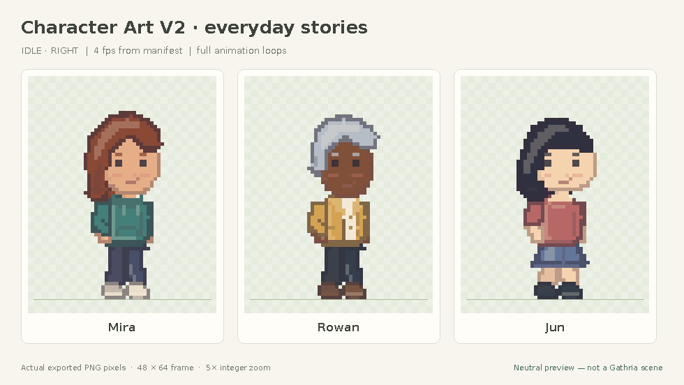

# Gathria Character

A standalone, browser-local pixel-art character studio. Customize a character, preview idle and walking animations, save editable configuration, and export a portable **CharacterPack v1** ZIP. A separate player consumes the exported PNG and metadata without invoking the generator.

**Character Art V2** adds rounded three-quarter faces, three face shapes, softer hair silhouettes, and casual/wedding outfits. The saved-character and export workflow stays the same; V1 files retain their original artwork.



[Matched before/after](docs/art-v2/before-after.png) · [Wedding/casual animation](docs/art-v2/outfits-motion.gif) · [Art review](docs/ART_V2_REVIEW.md) · [Studio screenshot](docs/art-v2/studio-v2.png)

## Run

Use Node.js 22.12+ (Node 24 recommended; `.nvmrc` selects 24).

```sh
npm ci
npm run dev
```

Open the address Vite prints. The studio is at `/`; the independent player is at `/player.html`. No API keys, account, backend, external artwork, or runtime network services are needed. All editing, generation, and file processing happens in the browser. Changes are not autosaved: **Save config** preserves your editable character.

```sh
npm run typecheck
npm test
npm run build
npm run preview
```

For the browser suite, install Playwright's browser once:

```sh
npx playwright install chromium
npm run test:e2e
```

In a cloud image with system Chromium already installed, use `CHROMIUM_PATH=/usr/bin/chromium npm run test:e2e` instead. Playwright starts its own Vite server on port 5175; it does not reuse a running development server. The GitHub Actions workflow installs the browser and Linux libraries before testing.

## Try the complete workflow

1. Start with **Mira**, **Rowan**, or **Jun**. Choose a face shape, skin, hairstyle, hair color, clothing cuts/colors, and shoes. Start with **Polished casual**, **Wedding suit**, or **Wedding dress**, then combine garments freely. The actual pixels update immediately.
2. Select **Idle** or **Walk**, face left/right, play/pause, adjust speed, and select an integer zoom. The ground line and frame strip show alignment and poses.
3. Name the character and choose **Save config**. Make other changes, then **Open saved configuration** to reopen the downloaded `.character.json`.
4. Choose **Export character** to download a ZIP containing `spritesheet.png`, `manifest.json`, `character.json`, `PROVENANCE.txt`, and `INTEGRATION.md`. **Download PNG only** is also available.
5. Open the independent player, choose the downloaded ZIP, and play both animations/directions. Alternatively, extract it and choose the actual PNG and manifest files. Configuration is optional for playback.

The player offers both **Try Mira’s Art V2 pack** and a clearly labeled original V1 example. Six new ZIPs and extracted files are in [`public/samples/v2/`](public/samples/v2/): Mira, Rowan, Jun, and Mira in each outfit. The original three V1 packs remain in [`public/samples/`](public/samples/).

Opening a V1 configuration keeps its original renderer and options. **Create Art V2 copy** explicitly opts into the new artwork. Configuration V2 requires `schemaVersion: 2`, `artworkVersion: 2`, and `faceVariant`; the portable **CharacterPack manifest remains version 1**.

With the dev server running, regenerate real exports and review artifacts:

```sh
# Original V1 samples only:
npm run samples
# New V2 packs and actual browser evidence:
node scripts/generate-art-v2-evidence.mjs
# Review images/GIFs assembled from exported PNGs (requires Python + Pillow):
python3 scripts/render-art-v2-review.py
```

Set `CHROMIUM_PATH=/usr/bin/chromium` before either Node command if using system Chromium. The browser recording uses Chromium’s built-in `MediaRecorder`.

## Architecture and scope

| Location                | Responsibility                                                           |
| ----------------------- | ------------------------------------------------------------------------ |
| `src/core/config.ts`    | Versioned, validated configuration, palettes, presets                    |
| `src/core/generator.ts` | Version dispatcher; frozen V1 and warm V2 renderers in adjacent files    |
| `src/core/types.ts`     | Small `CharacterGenerator` interface and shared contracts                |
| `src/core/pack.ts`      | Manifest/ZIP validation, PNG encoding/decoding, downloads                |
| `src/editor/`           | Customization UI, animated canvas, frame strip                           |
| `src/consumer/`         | Separate file-driven playback entrypoint, no generator/editor dependency |
| `src/compat/gathria.ts` | Isolated, explicitly unverified proposed integration boundary            |

Art V2 uses one stylized body rig, three face shapes, four hairstyles, five upper garments, and four lower garments. Native artwork faces right; the consumer mirrors it around the metadata anchor to face left. Both versions retain **48×64** frames, a **384×128** sheet, and anchor **(24, 60)**. V2 idle has **four drawings held over 12 timing steps at 4 fps** (3 seconds, including a blink); walking has **eight drawings at 10 fps**. V1 timing and pixels are unchanged. These are standalone choices, not verified Gathria requirements. Changing names affects metadata; changing appearance affects exported pixels.

A future provider can implement `CharacterGenerator.generate(config)` and return normalized pixels plus the same validated manifest. No photo or AI generation is implemented, and no speculative backend is included. Untrusted inputs have explicit schema, size, dimension, and decompression limits; errors preserve the last valid loaded character.

## Format, provenance, and compatibility

- [CharacterPack v1 contract](docs/CHARACTER_PACK_V1.md): exact fields, frame IDs, timing, mirroring, anchors, validation, consumer example.
- [Artwork provenance](docs/ASSET_PROVENANCE.md): original programmatically drawn layers/poses and MIT reuse terms. MIT notice is included in each pack; no visible in-game credit is required.
- [Gathria compatibility](docs/GATHRIA_COMPATIBILITY.md): **UNVERIFIED**. Read access to the candidate Gathria repository returned HTTP 403. No Gathria source was modified, and the proposed adapter is not an established runtime API.
- [Implementation status and handoff](docs/IMPLEMENTATION_STATUS.md): completed milestones, verification, delivery, and next action.

Verification covers pixel-exact V1 preservation, explicit V2 migration, deterministic pixels, distinct face silhouettes, outfit connectivity, all customization fields, frame margins/anchors, config round trips, malformed imports, manifest mapping, bounded ZIP loading, and actual download/reopen/playback in Chromium. The browser suite also checks mobile layout, PNG transparency, high zoom, and corrupt-image rejection. Firefox, Safari, and actual Gathria integration are not verified.

Source and original generated artwork are released under the [MIT License](LICENSE). React, Vite, fflate, Lucide, and the other packages retain their own licenses. This MVP does not include authentication, cloud storage, AI generation, or a general animation editor.
