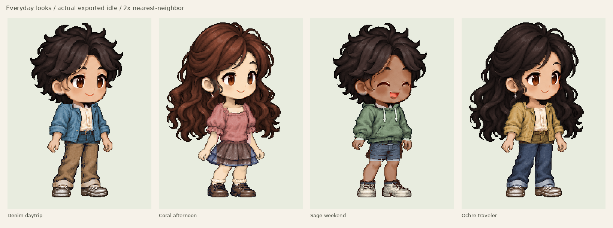

# Gathria Character

Current studio default: **Polished Art V6 with repaired compact running (`motionVersion: 3`)**. The V6 proportions, source art, idle and walk pixels are preserved. V7 was not accepted in visual review and is retained for comparison and saved-file compatibility. Opening any saved V1–V7 configuration preserves its original artwork and available actions.

A standalone, browser-local pixel-art character studio. Customize a character, preview idle, walking and running animations, save editable configuration, and export a portable **CharacterPack v1** ZIP. A separate player consumes the exported PNG and metadata without invoking the generator.



[Running joint/ownership repair and packs](docs/RUN_CONNECTIONS_REVIEW.md) · [Original everyday wardrobe](docs/EVERYDAY_REVIEW.md) · [Idle/walk/run preview](docs/everyday/action-switch.gif) · [Compact running review](docs/RUNNING_V2_REVIEW.md) · [Original running review](docs/RUNNING_REVIEW.md) · [V6 review](docs/ART_POLISH_V6.md) · [V7 comparison and rejection record](docs/ART_HARMONY_V7.md) · [Default restoration](docs/V6_DEFAULT_RESTORATION.md)

## Run

Use Node.js 22.12+ (Node 24 recommended; `.nvmrc` selects 24).

```sh
npm ci
npm run dev
```

Open the address Vite prints. The studio is at `/`; the independent player is at `/player.html`. No API keys, account, backend, or runtime generation services are needed. Prepared artwork ships with the app. All editing, generation, and file processing happens in the browser. Changes are not autosaved: **Save config** preserves your editable character.

The isolated [skeletal rig lab](docs/SKELETAL_RIG_REVIEW.md) is at `/rig-lab.html`: compare Denim's existing run with project-owned weighted-mesh animation, edit pose keys, save an authoring recipe and bake a portable pack. It uses no Spine dependency and leaves Studio defaults unchanged.

The [reusable Skin Studio](docs/REUSABLE_RIG_REVIEW.md) is at `/skin-studio.html`: Denim and Coral use one skeleton and motion library. Replace registered PNG parts, drag source joints, edit motion poses/timing with undo and redo, save complete skin/project ZIPs, and bake independent CharacterPacks. [The authoring tools review](docs/AUTHORING_TOOLS_REVIEW.md) covers the latest controls; [the material guide](docs/SKIN_PACK_V1.md) explains how to prepare another character without editing the renderer. This separate authoring app does not change the production Studio or historical files.

Skin Studio's wardrobe mixes identities, tops, bottoms, shoes and colors across
idle, walk, run and jump. **Your clothing** accepts reusable clothing ZIPs:
download a registered item template, prepare its artwork and masks, then import
it without editing application code. Save the project ZIP to keep all imported
items. [Portable clothing guide and verification](docs/WARDROBE_ITEMS_REVIEW.md).

**Your identities** also accepts registered character identity ZIPs with three
complete expressions and skin/hair masks. Import adds to the library without
changing the canvas; explicitly selecting an identity preserves the current
wardrobe. Saved projects embed both libraries. The
[Maple and Willow trial](docs/PORTABLE_IDENTITIES_REVIEW.md) demonstrates two
custom identities wearing three outfits through all four actions, with a new
generated character and cardigan set. See the [identity format guide](docs/IDENTITY_PACK_V1.md).

The [Theo and Rose pair](docs/REFERENCE_PAIR_REVIEW.md) adds a reference-guided
navy suit and coral dress with two reusable identities, six garment items and
three expressions each. [Actual previews and editable downloads](docs/reference-pair/README.md)
exercise the same skeleton through idle, walk, run and jump.

The [Theo complete-figure study](docs/THEO_POSE_STUDY_REVIEW.md) improves one
whole suit character before deriving reusable parts. It adds explicitly versioned
[source-relative clothing colors](docs/WARDROBE_ITEM_V3.md) and a project-owned
run trial while preserving the previous pair.

Its [run repair follow-up](docs/THEO_RUN_REPAIR_REVIEW.md) closes shoulder
coverage gaps and introduces an explicit [motion-library V2](docs/MOTION_LIBRARY_V2.md)
with shared-pelvis foot travel and grounded shoe/ankle support. The
[new project and before/after GIFs](docs/theo-run-repair/README.md) retain the
previous character's head and clothing design. Historical projects remain exact;
crowded boots in the passing pose remain a documented visual limitation.

```sh
npm run typecheck
npm test
npm run build
npm run preview
```

For the browser suite, install Playwright's browser once:

```sh
npx playwright install chromium
npm run test:e2e
```

In a cloud image with system Chromium already installed, use `CHROMIUM_PATH=/usr/bin/chromium npm run test:e2e` instead. Playwright starts its own Vite server on port 5175; it does not reuse a running development server. The GitHub Actions workflow installs the browser and Linux libraries before testing.

## Try the complete workflow

1. Start with **Mira**, **Rowan**, or **Jun**. Choose a face shape, expression, hair accessory, skin, hairstyle, hair color, clothing cuts/colors, and shoes. Choose **Denim daytrip**, **Coral afternoon**, **Sage weekend** or **Ochre traveler** under **Everyday looks**, then combine garments freely. These outfit cards preserve your identity and action while removing the rose hairpiece. Original casual and wedding starting points remain available. The actual pixels update immediately.
2. Select **Idle**, **Walk** or **Run**, face left/right, play/pause, adjust speed, and select an integer zoom. The ground line and frame strip show alignment and poses. These are in-place previews, without travel through a scene.
3. Name the character and choose **Save config**. Make other changes, then **Open saved configuration** to reopen the downloaded `.character.json`. Running-enabled files also save the selected action and facing direction.
4. Choose **Export character** to download a ZIP containing `spritesheet.png`, `manifest.json`, `character.json`, `PROVENANCE.txt`, and `INTEGRATION.md`. **Download PNG only** is also available.
5. Open the independent player, choose the downloaded ZIP, and play the available animations in either direction. Alternatively, extract it and choose the actual PNG and manifest files. Configuration is optional for playback. Older packs without running display a disabled **Run** action and an explanation.

The player’s main example is the **repaired Denim daytrip** and retains compact wedding, original running, V6 wedding, V7 comparison and V4, V3, V2 and V1 examples. [Four repaired everyday ZIPs and matched review media](docs/RUN_CONNECTIONS_REVIEW.md) are ready to load independently. Retained wedding [bride](public/samples/running-v2/dress.character.zip) and [groom](public/samples/running-v2/suit.character.zip) ZIPs are self-contained. [Compact running exports and checks](docs/running-v2/) include extracted files; [original V6 exports](docs/art-polished/) and [V7 comparison exports](docs/art-harmonized/) remain available. Older sample directories remain unchanged.

Opening any V1–V7 configuration keeps its original renderer and options. For V1–V5 files, **Create polished copy** explicitly opts into V6. For a historical V6 file, **Add running** explicitly enables `motionVersion: 3` while retaining the exact existing idle/walk atlas rows. Original Motion 1 files retain their saved poses; **Create compact running copy** explicitly upgrades their run while retaining appearance and preview settings. V7 is never converted automatically and does not offer running. Motion 1 and 2 files offer **Create corrected running copy** for an explicit opt-in to the limb repair. New configuration uses `schemaVersion: 2`, `artworkVersion: 6`, `motionVersion: 3`, `faceVariant`, `expression` (`neutral`, `gentle`, `joyful`) and `hairAccessory`. Running-enabled files optionally include `preview: { animation, facing }`; old files do not gain preview fields merely by opening or saving them. The portable **CharacterPack manifest remains version 1**, with optional `animations.run`. Whole-face expressions cover waves/crop; the other two hairstyles retain their original open-eye face and show a studio notice.

For the current limb repair, follow [the matched evidence instructions](docs/run-connections/README.md#reproduction); frozen before exports must not be overwritten. Regenerate historical compact running evidence sequentially with `node scripts/generate-running-v2-evidence.mjs`, `python3 scripts/render-running-v2-review.py`, then `python3 scripts/verify-running-v2-evidence.py`. The original running scripts still reproduce Motion 1. The export step must finish before rendering review media. See the [compact running review](docs/RUNNING_V2_REVIEW.md) for the frozen V6 baseline, iteration record, commands and that batch’s historical verification results.

Regenerate V6 export evidence with `node scripts/generate-polished-evidence.mjs`, then `python3 scripts/render-polished-review.py` and `python3 scripts/verify-polished-evidence.py`. The corresponding `harmonized` scripts reproduce the retained V7 comparison. The first command starts its own server. Requirements and verified commands are in the [V6 review](docs/ART_POLISH_V6.md). `npm run samples` still regenerates only original V1 samples.

The shared rig now supports **idle, walk, run and a one-shot jump**. In Skin Studio, enable **Skeleton only** to inspect the foundation without artwork, then apply the same actions to registered skins. Older projects gain jump only through **Add jump action**. See [basic actions review](docs/BASIC_ACTIONS_REVIEW.md) for the actual previews, exports and current limitations.

Skin Studio also offers an opt-in **Wardrobe**: keep one identity while combining two tops, two bottoms and two shoe designs, with separate skin and clothing colors. Save the full project to retain clothing choices, or bake a CharacterPack for independent playback. The registered collection uses the same skeleton and four actions. [Wardrobe review and actual exports](docs/WARDROBE_MVP_REVIEW.md) describe the supported combinations, compatibility and material limits.

## Architecture and scope

For a complete **newly generated source → registered parts → shared skeleton →
four actions → independent playback** example, see the
[Maple pipeline review](docs/GENERATED_CHARACTER_REVIEW.md) and
[downloadable source projects, clothing and previews](docs/generated-traveler/README.md).
The [action-forearm follow-up](docs/MAPLE_ACTION_POSES_REVIEW.md) adds registered
closed hands for run/jump through opt-in skin/top-item v2, preserves idle/walk,
and records the remaining knee-fold limitation.
This trial exposes and repairs duplicate sleeves, pelvis ownership and wrist
material masks. The source art is new; runtime skeleton and motions are shared.
That trial's flat identity limitation is addressed by the opt-in
[portable identity follow-up](docs/PORTABLE_IDENTITIES_REVIEW.md). Earlier flat
files and outputs remain unchanged; new editable examples explicitly embed an
identity library and wardrobe recipe v3.

| Location                                                                                               | Responsibility                                                                      |
| ------------------------------------------------------------------------------------------------------ | ----------------------------------------------------------------------------------- |
| `src/core/config.ts`                                                                                   | Versioned, validated configuration, palettes, presets                               |
| `src/core/generator.ts`                                                                                | Artwork/motion dispatcher; frozen V1–V7 and opt-in V6 running                       |
| `src/core/generator-motion-v1.ts`, `running-rig.ts`                                                    | Append running frames from existing V6 layers; preserve original idle/walk          |
| `src/core/generator-motion-v3.ts`, `running-rig-v3.ts`, `running-arm-parts.ts`, `running-leg-parts.ts` | Run-only anatomical ownership and continuous source-textured knee/ankle connections |
| `src/core/generator-motion-v2.ts`, `running-rig-v2.ts`                                                 | Compact fore/aft arm pump and folded leg recovery; frozen original motion retained  |
| `src/core/everyday-presets.ts`                                                                         | Four freely editable daily outfit combinations and complete example configurations  |
| `src/core/types.ts`                                                                                    | Small `CharacterGenerator` interface and shared contracts                           |
| `src/core/pack.ts`                                                                                     | Manifest/ZIP validation, PNG encoding/decoding, downloads                           |
| `src/editor/`                                                                                          | Customization UI, animated canvas, frame strip                                      |
| `src/consumer/`                                                                                        | Separate file-driven playback entrypoint, no generator/editor dependency            |
| `src/compat/gathria.ts`                                                                                | Isolated, explicitly unverified proposed integration boundary                       |

The detailed renderer uses one articulated body rig, three face shapes, four hairstyles, five upper garments, and four lower garments. Hair, skin, clothing, and shoe colors remain editable. Native artwork faces right; playback mirrors it around the metadata anchor to face left.

| Artwork         | Frame   | Sheet     | Ground anchor | Recommended zoom |
| --------------- | ------- | --------- | ------------- | ---------------- |
| Preserved V1/V2 | 48×64   | 384×128   | (24, 60)      | 4×               |
| Detailed V3–V7  | 192×256 | 1536×512  | (96, 240)     | 1×               |
| V6 + motion 1/2 | 192×256 | 1536×1024 | (96, 240)     | 1×               |

The larger detailed frame retains eye highlights, curling strands, and layered cloth at native size. V6/V7 idle holds four drawings over twelve steps at 4 fps (3 seconds); walking has eight drawings at 10 fps (0.8 seconds). Both motion versions append twelve running timeline frames at 18 fps (2/3 second) below the two unchanged V6 rows. Run uses coordinated forward lean, bent arms, alternating legs and delayed hair/cloth motion; the floor-length bride uses a restrained, two-handed gown-holding trot with the shoes concealed. All older pixels and timings remain unchanged. These dimensions are standalone choices, not verified Gathria requirements. Names and saved preview choices do not affect exported pixels.

A future provider can implement `CharacterGenerator.generate(config)` and return normalized pixels plus the same validated manifest. The detailed source illustrations were created with AI assistance during development, then prepared into bundled layers. Runtime generation is deterministic and local; photo input and AI generation as product features are not implemented. Untrusted inputs have explicit schema, size, dimension, and decompression limits; errors preserve the last valid loaded character.

## Format, provenance, and compatibility

- [CharacterPack v1 contract](docs/CHARACTER_PACK_V1.md): exact fields, frame IDs, timing, mirroring, anchors, validation, consumer example.
- [Artwork provenance](docs/ASSET_PROVENANCE.md): preserved procedural art, AI-assisted detailed source assets, preparation, and MIT reuse terms. MIT notice is included in each pack; no visible in-game credit is required.
- [Gathria compatibility](docs/GATHRIA_COMPATIBILITY.md): **UNVERIFIED**. Read access to the candidate Gathria repository returned HTTP 403. No Gathria source was modified, and the proposed adapter is not an established runtime API.
- [Implementation status and handoff](docs/IMPLEMENTATION_STATUS.md): completed milestones, verification, delivery, and next action.

Verification covers pixel-exact V1–V7 preservation and explicit V6-copy migration for older files, deterministic pixels, distinct face silhouettes, outfit connectivity, all customization fields, frame margins/anchors, config round trips, malformed imports, manifest mapping, bounded ZIP loading, and actual download/reopen/playback in Chromium. The browser suite also checks mobile layout, PNG transparency, high zoom, and corrupt-image rejection. Firefox, Safari, and actual Gathria integration are not verified.

Source and original generated artwork are released under the [MIT License](LICENSE). React, Vite, fflate, Lucide, and the other packages retain their own licenses. The app does not include authentication, cloud storage, photo/AI input, or a general animation editor.
