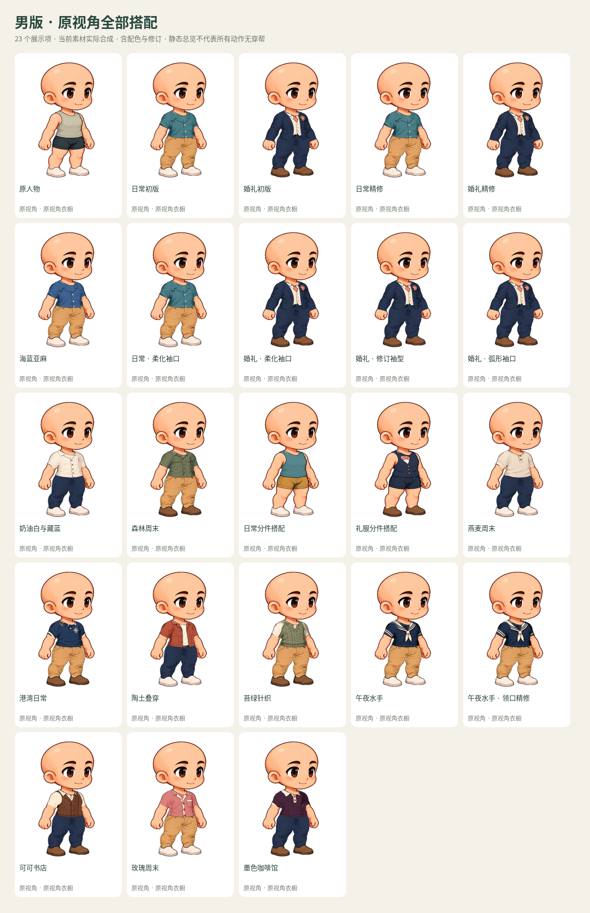
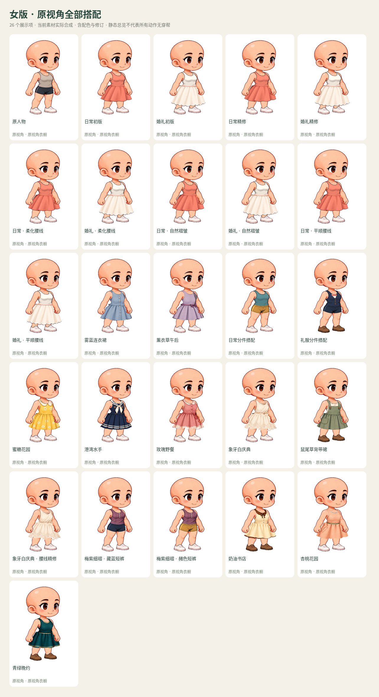

# Kling 人物、造型与服装总集

**在线图册：** [全部搭配](looks.md) · [单件服装](garments.md) · [发型与发色](hair.md) · [表情](faces.md) · [完整主题](themes.md) · [原人物](originals.md)

**[下载可筛选的离线浏览包（约58 MB）](https://github.com/hanxuwu/gathria-character/raw/refs/heads/docs/character-collection/docs/character-collection/collection-preview.zip)** · [完整清单 CSV](collection.csv)

上方图册在 GitHub 里直接显示图片。可交互的筛选页面在 ZIP 内；GitHub 上的 `index.html` 只是源码预览，不是已托管的网站。

这是当前 main `e01fada2568bfb42808d6c90d9d89ce2451237a4` 的独立只读总集，不增加应用主入口，也不改变人物、服装或默认动作。

## 收录范围

| 分类 | 展示项 | 说明 |
| --- | ---: | --- |
| 整套搭配 | 88 | 81 条穿衣搭配、7 条原人物；包含视角、配色和仍可选的旧修订，不是 88 款独立设计 |
| 单件服装 | 113 | 当前21组目录的所有独立衣物文件；每件提供站立与跑步静帧 |
| 发型与发色 | 57 | 不同来源适配的发型×发色展示；原视角每个人6款发型、3种发色 |
| 表情 | 20 | 男女及不同视角的当前/早期表情与自然对照 |
| 完整主题 | 12 | 8 个当前、4 个仍可选的早期像素主题造型；完整烘焙角色，不是独立服装 |
| 原人物外观 | 2 | 男女原人物对照 |

衣物 ZIP 约502 MB，未重复塞进浏览包。每张卡片提供配方和固定到该提交的原始素材下载链接；下载衣物仍需联网。衣物文件要搭配相应源人物与定位文件，不能当作独立 CharacterPack 播放。

不在当前目录中的43个历史服装包列在页面末尾的归档索引中，未混入当前113个文件。任意混搭、发型×服装全组合以及算法像素化的无限设置组合没有穷举。算法像素化在现有工作台中按当前造型生成。

## 快速看图

- [男版原视角 · 23项](sheets/male-original-looks.png)
- [女版原视角 · 26项](sheets/female-original-looks.png)
- [男版侧视](sheets/male-side-looks.png) · [女版侧视](sheets/female-side-looks.png)
- [全部双视角系列](sheets/paired-looks.png)
- [男版发型与发色](sheets/male-hair.png) · [女版发型与发色](sheets/female-hair.png)
- [完整主题](sheets/themes.png)

服装预览统一保留原人物头部，方便比较剪裁；它不是强制光头的搭配。发型与表情在工作台中独立选择。单件服装只替换该件，其余身体部位仍穿原衣，避免将一个未声明的混搭误叫成内置套装。

站立/跑步是两张静态目录图，不是动画。衣物缩略图对每个源人物使用同一展示裁剪、等比缩放与放置，不会在切换这两个姿势时分别自动居中。原生透明 PNG 由生产合成器生成，完整尺寸和 SHA 保留在 `clothing/manifest.json`；外观原生图与头部裁切记录在 `appearance/manifest.json`。浏览包只装展示图、总览和索引，不含大体积原生核验图。原生核验 PNG 也未重复提交到 GitHub；清单中的 `nativePath` 是可用脚本重建的本地核验路径，不是在线下载链接。

## 打开

解压 `collection-preview.zip` 后打开 `index.html`。如果浏览器限制本地 HTML，可以在解压目录运行：

```sh
python3 -m http.server 4175
```

然后访问 `http://localhost:4175/`。页面的筛选、搜索、放大和图片预览无需外部网络；原始素材下载需要连接 GitHub。

目录可按类别、人物、视角、系列筛选，并搜索中英文名称及服装 ID。点击卡片查看放大图、配方与素材下载。外观与主题的“早期版本”“实验候选”独立标注。查看历史修订不代表它比当前推荐款更成熟。

## 核验与边界

- 当前113个独立衣物与88条预设全部有实际合成预览，去重后354张原生服装PNG。
- 91张外观/主题原生PNG与77张头部裁切经过尺寸、SHA与像素核验。
- 浏览器核对筛选、搜索、详情、两种姿势、手机宽度，以及阻断外部请求后的本地浏览。
- 当前受管浏览器禁止 `file://` 导航；直接文件模式未在此环境完成验证。本地HTTP浏览不受影响。
- 这份总集是选款目录。静态渲染和格式检查不代表困难姿势或任意混搭的美术验收；已知边界继续参照[接缝修订](../wardrobe-finish/README.md)。

复现生成：

```sh
node scripts/render-character-clothing-collection.mjs
node scripts/render-character-appearance-collection.mjs
python scripts/present-character-collection.py
python scripts/publish-character-collection-gallery.py
python scripts/package-character-collection.py
```

`inventory.json` 是本次中文索引快照，`collection.json` 保存每张展示图与原生图的哈希、具体姿势与配方。全部预览来自现有素材，没有新增生成画稿。

## 直接看总览

### 男版原视角



### 女版原视角



更多视角与单件服装请使用页首分类图册。
