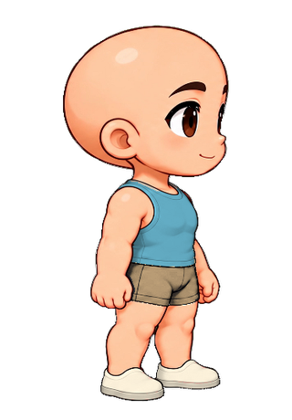
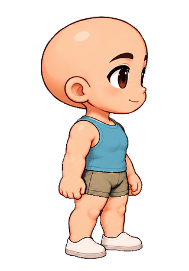
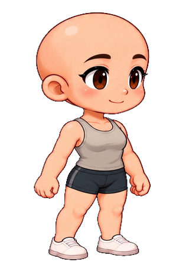
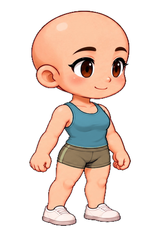

# 全部搭配 · 88 项

[返回总集](README.md) · [全部搭配](looks.md) · [单件服装](garments.md) · [发型与发色](hair.md) · [表情](faces.md) · [完整主题](themes.md) · [原人物](originals.md)

图片可直接在线查看；点击图片放大。分组保留视角、配色与修订，展示项不等于独立设计数。

## 男版

### 原视角衣橱 · 原视角

|  |  |  |  |
| --- | --- | --- | --- |
|  **原人物** 原视角 <code>original</code> [查看跑步姿势](preview/028-run.png) |  **日常初版** 原视角 <code>day</code> [查看跑步姿势](preview/029-run.png) |  **婚礼初版** 原视角 <code>wedding</code> [查看跑步姿势](preview/030-run.png) |  **日常精修** 原视角 <code>day-refined</code> [查看跑步姿势](preview/031-run.png) |
|  **婚礼精修** 原视角 <code>wedding-refined</code> [查看跑步姿势](preview/032-run.png) |  **海蓝亚麻** 原视角 <code>ocean-linen</code> [查看跑步姿势](preview/033-run.png) |  **日常 · 柔化袖口** 原视角 <code>day-soft-cuff</code> [查看跑步姿势](preview/034-run.png) |  **婚礼 · 柔化袖口** 原视角 <code>wedding-soft-cuff</code> [查看跑步姿势](preview/035-run.png) |
|  **婚礼 · 修订袖型** 原视角 <code>wedding-reviewed-sleeve</code> [查看跑步姿势](preview/036-run.png) |  **婚礼 · 弧形袖口** 原视角 <code>wedding-curved-cuff</code> [查看跑步姿势](preview/037-run.png) |  **奶油白与藏蓝** 原视角 <code>cream-navy</code> [查看跑步姿势](preview/038-run.png) |  **森林周末** 原视角 <code>forest-weekend</code> [查看跑步姿势](preview/039-run.png) |
|  **日常分件搭配** 原视角 <code>separates</code> [查看跑步姿势](preview/040-run.png) |  **礼服分件搭配** 原视角 <code>formal-separates</code> [查看跑步姿势](preview/041-run.png) |  **燕麦周末** 原视角 <code>oat-weekend</code> [查看跑步姿势](preview/042-run.png) |  **港湾日常** 原视角 <code>harbor-day</code> [查看跑步姿势](preview/043-run.png) |
|  **陶土叠穿** 原视角 <code>terracotta-layer</code> [查看跑步姿势](preview/044-run.png) |  **苔绿针织** 原视角 <code>moss-knit</code> [查看跑步姿势](preview/045-run.png) |  **午夜水手** 原视角 <code>midnight-sailor</code> [查看跑步姿势](preview/046-run.png) |  **午夜水手 · 领口精修** 原视角 <code>midnight-sailor-refined</code> [查看跑步姿势](preview/047-run.png) |
|  **可可书店** 原视角 <code>cocoa-bookshop</code> [查看跑步姿势](preview/048-run.png) |  **玫瑰周末** 原视角 <code>rose-weekend</code> [查看跑步姿势](preview/049-run.png) |  **墨色咖啡馆** 原视角 <code>ink-cafe</code> [查看跑步姿势](preview/050-run.png) |  |

### 侧视 · 基础棉质 · 侧视

|  |  |  |  |
| --- | --- | --- | --- |
|  **原人物** 侧视 <code>original</code> [查看跑步姿势](preview/109-run.png) |  **日常装** 侧视 <code>daily</code> [查看跑步姿势](preview/110-run.png) |  |  |

### 侧视 · 衬衫与裙裤 · 侧视

|  |  |  |  |
| --- | --- | --- | --- |
|  **原人物** 侧视 <code>original</code> [查看跑步姿势](preview/113-run.png) |  **日常装** 侧视 <code>daily</code> [查看跑步姿势](preview/114-run.png) |  |  |

### 男版落地候选 · 侧视

|  |  |  |  |
| --- | --- | --- | --- |
|  **原人物 · 落地候选** 侧视 · 实验候选 <code>original</code> [查看跑步姿势](preview/128-run.png) |  **日常装 · 落地候选** 侧视 · 实验候选 <code>daily</code> [查看跑步姿势](preview/129-run.png) |  **婚礼西装 · 落地候选** 侧视 · 实验候选 <code>wedding</code> [查看跑步姿势](preview/130-run.png) |  |

### 双视角 · 轻便日常 · 原视角

|  |  |  |  |
| --- | --- | --- | --- |
|  **轻便日常 · 海盐蓝／沙色** 原视角 <code>cotton-day-sea</code> [查看跑步姿势](preview/135-run.png) |  **轻便日常 · 暖杏色／蓝灰** 原视角 <code>cotton-day-apricot</code> [查看跑步姿势](preview/136-run.png) |  |  |

### 双视角 · 轻便日常 · 侧视

|  |  |  |  |
| --- | --- | --- | --- |
|  **轻便日常 · 海盐蓝／沙色** 侧视 <code>cotton-day-sea</code> [查看跑步姿势](preview/141-run.png) |  **轻便日常 · 暖杏色／蓝灰** 侧视 <code>cotton-day-apricot</code> [查看跑步姿势](preview/142-run.png) |  |  |

### 双视角 · 新款日常 · 原视角

|  |  |  |  |
| --- | --- | --- | --- |
|  **双视角日常 · 海盐蓝／沙色** 原视角 <code>tailored-day-sea</code> [查看跑步姿势](preview/159-run.png) |  **双视角日常 · 暖杏色／蓝灰** 原视角 <code>tailored-day-apricot</code> [查看跑步姿势](preview/160-run.png) |  |  |

### 双视角 · 新款日常 · 侧视

|  |  |  |  |
| --- | --- | --- | --- |
|  **双视角日常 · 海盐蓝／沙色** 侧视 <code>tailored-day-sea</code> [查看跑步姿势](preview/165-run.png) |  **双视角日常 · 暖杏色／蓝灰** 侧视 <code>tailored-day-apricot</code> [查看跑步姿势](preview/166-run.png) |  |  |

### 双视角 · 接缝修订 · 原视角

|  |  |  |  |
| --- | --- | --- | --- |
|  **双视角日常 · 接缝修订 · 海盐蓝／沙色** 原视角 <code>polished-day-sea</code> [查看跑步姿势](preview/187-run.png) |  **双视角日常 · 接缝修订 · 暖杏色／蓝灰** 原视角 <code>polished-day-apricot</code> [查看跑步姿势](preview/188-run.png) |  |  |

### 双视角 · 接缝修订 · 侧视

|  |  |  |  |
| --- | --- | --- | --- |
|  **双视角日常 · 接缝修订 · 海盐蓝／沙色** 侧视 <code>polished-day-sea</code> [查看跑步姿势](preview/191-run.png) |  **双视角日常 · 接缝修订 · 暖杏色／蓝灰** 侧视 <code>polished-day-apricot</code> [查看跑步姿势](preview/192-run.png) |  |  |

## 女版

### 原视角衣橱 · 原视角

|  |  |  |  |
| --- | --- | --- | --- |
|  **原人物** 原视角 <code>original</code> [查看跑步姿势](preview/080-run.png) |  **日常初版** 原视角 <code>day</code> [查看跑步姿势](preview/081-run.png) |  **婚礼初版** 原视角 <code>wedding</code> [查看跑步姿势](preview/082-run.png) |  **日常精修** 原视角 <code>day-refined</code> [查看跑步姿势](preview/083-run.png) |
|  **婚礼精修** 原视角 <code>wedding-refined</code> [查看跑步姿势](preview/084-run.png) |  **日常 · 柔化腰线** 原视角 <code>day-soft-waist</code> [查看跑步姿势](preview/085-run.png) |  **婚礼 · 柔化腰线** 原视角 <code>wedding-soft-waist</code> [查看跑步姿势](preview/086-run.png) |  **日常 · 自然褶皱** 原视角 <code>day-native-folds</code> [查看跑步姿势](preview/087-run.png) |
|  **婚礼 · 自然褶皱** 原视角 <code>wedding-native-folds</code> [查看跑步姿势](preview/088-run.png) |  **日常 · 平顺腰线** 原视角 <code>day-smooth-waist</code> [查看跑步姿势](preview/089-run.png) |  **婚礼 · 平顺腰线** 原视角 <code>wedding-smooth-waist</code> [查看跑步姿势](preview/090-run.png) |  **雾蓝连衣裙** 原视角 <code>mist-blue</code> [查看跑步姿势](preview/091-run.png) |
|  **薰衣草午后** 原视角 <code>lavender-afternoon</code> [查看跑步姿势](preview/092-run.png) |  **日常分件搭配** 原视角 <code>separates</code> [查看跑步姿势](preview/093-run.png) |  **礼服分件搭配** 原视角 <code>formal-separates</code> [查看跑步姿势](preview/094-run.png) |  **蜜糖花园** 原视角 <code>honey-garden</code> [查看跑步姿势](preview/095-run.png) |
|  **港湾水手** 原视角 <code>harbor-sailor</code> [查看跑步姿势](preview/096-run.png) |  **玫瑰野餐** 原视角 <code>rose-picnic</code> [查看跑步姿势](preview/097-run.png) |  **象牙白庆典** 原视角 <code>ivory-celebration</code> [查看跑步姿势](preview/098-run.png) |  **鼠尾草背带裙** 原视角 <code>sage-pinafore</code> [查看跑步姿势](preview/099-run.png) |
|  **象牙白庆典 · 腰线精修** 原视角 <code>ivory-refined</code> [查看跑步姿势](preview/100-run.png) |  **梅紫细褶 · 藏蓝短裤** 原视角 <code>plum-pintuck-day</code> [查看跑步姿势](preview/101-run.png) |  **梅紫细褶 · 赭色短裤** 原视角 <code>plum-pintuck-ochre</code> [查看跑步姿势](preview/102-run.png) |  **奶油书店** 原视角 <code>butter-bookshop</code> [查看跑步姿势](preview/103-run.png) |
|  **杏桃花园** 原视角 <code>apricot-garden</code> [查看跑步姿势](preview/104-run.png) |  **青绿晚约** 原视角 <code>teal-evening</code> [查看跑步姿势](preview/105-run.png) |  |  |

### 侧视 · 基础棉质 · 侧视

|  |  |  |  |
| --- | --- | --- | --- |
|  **原人物** 侧视 <code>original</code> [查看跑步姿势](preview/118-run.png) |  **日常装** 侧视 <code>daily</code> [查看跑步姿势](preview/119-run.png) |  |  |

### 侧视 · 衬衫与裙裤 · 侧视

|  |  |  |  |
| --- | --- | --- | --- |
|  **原人物** 侧视 <code>original</code> [查看跑步姿势](preview/122-run.png) |  **日常装** 侧视 <code>daily</code> [查看跑步姿势](preview/123-run.png) |  |  |

### 双视角 · 轻便日常 · 原视角

|  |  |  |  |
| --- | --- | --- | --- |
|  **轻便日常 · 海盐蓝／沙色** 原视角 <code>cotton-day-sea</code> [查看跑步姿势](preview/147-run.png) |  **轻便日常 · 暖杏色／蓝灰** 原视角 <code>cotton-day-apricot</code> [查看跑步姿势](preview/148-run.png) |  |  |

### 双视角 · 轻便日常 · 侧视

|  |  |  |  |
| --- | --- | --- | --- |
|  **轻便日常 · 海盐蓝／沙色** 侧视 <code>cotton-day-sea</code> [查看跑步姿势](preview/153-run.png) |  **轻便日常 · 暖杏色／蓝灰** 侧视 <code>cotton-day-apricot</code> [查看跑步姿势](preview/154-run.png) |  |  |

### 双视角 · 新款日常 · 原视角

|  |  |  |  |
| --- | --- | --- | --- |
|  **双视角日常 · 海盐蓝／沙色** 原视角 <code>tailored-day-sea</code> [查看跑步姿势](preview/171-run.png) |  **双视角日常 · 暖杏色／蓝灰** 原视角 <code>tailored-day-apricot</code> [查看跑步姿势](preview/172-run.png) |  |  |

### 双视角 · 新款日常 · 侧视

|  |  |  |  |
| --- | --- | --- | --- |
|  **双视角日常 · 海盐蓝／沙色** 侧视 <code>tailored-day-sea</code> [查看跑步姿势](preview/177-run.png) |  **双视角日常 · 暖杏色／蓝灰** 侧视 <code>tailored-day-apricot</code> [查看跑步姿势](preview/178-run.png) |  |  |

### 双视角 · 完整日常 · 原视角

|  |  |  |  |
| --- | --- | --- | --- |
|  **女版裙摆修订 · 海盐蓝／沙色** 原视角 <code>complete-day-sea</code> [查看跑步姿势](preview/179-run.png) |  **女版裙摆修订 · 暖杏色／蓝灰** 原视角 <code>complete-day-apricot</code> [查看跑步姿势](preview/180-run.png) |  |  |

### 双视角 · 完整日常 · 侧视

|  |  |  |  |
| --- | --- | --- | --- |
|  **女版裙摆修订 · 海盐蓝／沙色** 侧视 <code>complete-day-sea</code> [查看跑步姿势](preview/185-run.png) |  **女版裙摆修订 · 暖杏色／蓝灰** 侧视 <code>complete-day-apricot</code> [查看跑步姿势](preview/186-run.png) |  |  |

### 双视角 · 接缝修订 · 原视角

|  |  |  |  |
| --- | --- | --- | --- |
|  **双视角日常 · 接缝修订 · 海盐蓝／沙色** 原视角 <code>polished-day-sea</code> [查看跑步姿势](preview/193-run.png) |  **双视角日常 · 接缝修订 · 暖杏色／蓝灰** 原视角 <code>polished-day-apricot</code> [查看跑步姿势](preview/194-run.png) |  |  |

### 双视角 · 接缝修订 · 侧视

|  |  |  |  |
| --- | --- | --- | --- |
|  **双视角日常 · 接缝修订 · 海盐蓝／沙色** 侧视 <code>polished-day-sea</code> [查看跑步姿势](preview/199-run.png) |  **双视角日常 · 接缝修订 · 暖杏色／蓝灰** 侧视 <code>polished-day-apricot</code> [查看跑步姿势](preview/200-run.png) |  |  |

完整配方与来源：[清单 CSV](collection.csv) · [素材索引 JSON](collection.json)。
