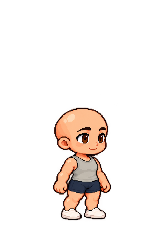
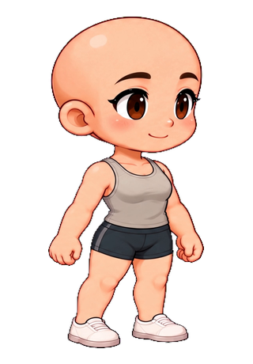
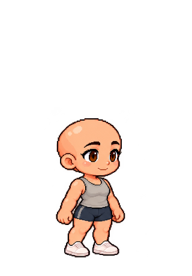

# 完整主题 · 12 项

[返回总集](README.md) · [全部搭配](looks.md) · [单件服装](garments.md) · [发型与发色](hair.md) · [表情](faces.md) · [完整主题](themes.md) · [原人物](originals.md)

图片可直接在线查看；点击图片放大。分组保留视角、配色与修订，展示项不等于独立设计数。

## 男版

### Kling original · 原视角

|  |  |  |  |
| --- | --- | --- | --- |
|  **Kling 原画 · 基础造型 · R1** 原视角 <code>theme-male-kling-original-1-base</code> |  **Kling 原画 · 婚礼 · R1** 原视角 <code>theme-male-kling-original-1-wedding</code> |  |  |

### Pixel storybook · 原视角

|  |  |  |  |
| --- | --- | --- | --- |
|  **像素童话 · 基础造型 · R2** 原视角 <code>theme-male-pixel-storybook-2-base</code> |  **像素童话 · 婚礼 · R2** 原视角 <code>theme-male-pixel-storybook-2-wedding</code> |  |  |

### Pixel storybook · 原视角

|  |  |  |  |
| --- | --- | --- | --- |
|  **像素童话 · 基础造型 · R1** 原视角 · 早期版本 <code>theme-male-pixel-storybook-1-base</code> |  **像素童话 · 婚礼 · R1** 原视角 · 早期版本 <code>theme-male-pixel-storybook-1-wedding</code> |  |  |

## 女版

### Kling original · 原视角

|  |  |  |  |
| --- | --- | --- | --- |
|  **Kling 原画 · 基础造型 · R1** 原视角 <code>theme-female-kling-original-1-base</code> |  **Kling 原画 · 婚礼 · R1** 原视角 <code>theme-female-kling-original-1-wedding</code> |  |  |

### Pixel storybook · 原视角

|  |  |  |  |
| --- | --- | --- | --- |
|  **像素童话 · 基础造型 · R2** 原视角 <code>theme-female-pixel-storybook-2-base</code> |  **像素童话 · 婚礼 · R2** 原视角 <code>theme-female-pixel-storybook-2-wedding</code> |  |  |

### Pixel storybook · 原视角

|  |  |  |  |
| --- | --- | --- | --- |
|  **像素童话 · 基础造型 · R1** 原视角 · 早期版本 <code>theme-female-pixel-storybook-1-base</code> |  **像素童话 · 婚礼 · R1** 原视角 · 早期版本 <code>theme-female-pixel-storybook-1-wedding</code> |  |  |

完整配方与来源：[清单 CSV](collection.csv) · [素材索引 JSON](collection.json)。
