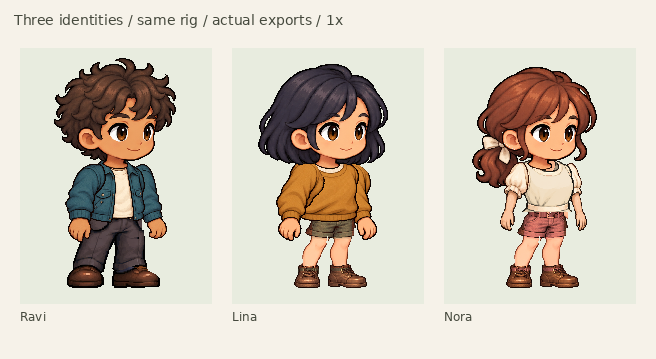

# Ravi, Lina and Nora — actual application exports

Three new identities use the existing modular character system. Every final
PNG/GIF below is captured from Skin Studio or composed from its exported atlas.
Generated source illustrations are kept separately under
[`artwork/character-roster`](../../artwork/character-roster/README.md).

[Findings, fixes and limitations](../CHARACTER_ROSTER_REVIEW.md) ·
[Current verification](verification-results.json)



## Download and play

Open an editable project in `/skin-studio.html`, or load a CharacterPack in
`/player.html`. The standalone packs require only their PNG and manifest and
contain idle, walk, run and non-looping jump. The saved projects retain clothing,
identity libraries, colors, expressions and fitted motion profiles.

| Character | Editable project              | CharacterPack                   | Right run                          | Left run                          | Four-action preview                         |
| --------- | ----------------------------- | ------------------------------- | ---------------------------------- | --------------------------------- | ------------------------------------------- |
| Ravi      | [Project](final/ravi.rig.zip) | [ZIP](final/ravi.character.zip) | [GIF](final/ravi-run-right-2x.gif) | [GIF](final/ravi-run-left-2x.gif) | [GIF](final/ravi-four-actions-right-2x.gif) |
| Lina      | [Project](final/lina.rig.zip) | [ZIP](final/lina.character.zip) | [GIF](final/lina-run-right-2x.gif) | [GIF](final/lina-run-left-2x.gif) | [GIF](final/lina-four-actions-right-2x.gif) |
| Nora      | [Project](final/nora.rig.zip) | [ZIP](final/nora.character.zip) | [GIF](final/nora-run-right-2x.gif) | [GIF](final/nora-run-left-2x.gif) | [GIF](final/nora-four-actions-right-2x.gif) |

Previews are **in place** against a neutral background. They do not demonstrate
world-motion speed or production Gathria scene integration. Nora's playable
outfit uses coral shorts; her rejected skirt trial is not hidden in these packs.

## Inspect the result

- Lineup: [1×](final/lineup-1x.png), [2×](final/lineup-2x.png).
- Four actions: [1×](final/four-actions-1x.png), [2×](final/four-actions-2x.png).
- Three expressions: [idle](final/expressions-idle-2x.png), [run](final/expressions-run-2x.png).
- [Head, neck and shoulders](final/head-neck-shoulders-3x.png).
- Twelve run poses: [Ravi](final/ravi-run-keyframes-2x.png), [Lina](final/lina-run-keyframes-2x.png), [Nora](final/nora-run-keyframes-2x.png). Corresponding `-1x.png` files preserve native size.
- [Dark skin, light hair and joyful-expression combinations](final/recolor-and-joyful-2x.png).
- Known defects: [Ravi face-tone variation](final/ravi-expression-face-tone-3x.png), [deep jump knee notch](final/lina-jump-knee-3x.png).
- [Application export/playback record](final/evidence-index.json), [decoded artifact checks](final/artifact-validation.json), [file integrity](final/file-integrity.json).

The final directory also includes separate idle/walk/jump and left-facing
action-tour GIFs, screenshots of closed-editor playback and unpacked manifests.
Failed skirt-fitting projects and the rejected expression candidate are retained
as explicitly labeled [diagnostic iterations](../../artwork/character-roster/prepared/iterations/).

## Reproduce

```sh
node scripts/prepare-roster-tops.mjs
node scripts/prepare-character-roster.mjs
EVIDENCE_PHASE=iterations/recheck node scripts/generate-character-roster-evidence.mjs
EVIDENCE_PHASE=iterations/recheck python3 scripts/render-character-roster-review.py
```

Use a new evidence phase: the capture script refuses to overwrite an existing
delivery. Chromium is selected with `CHROMIUM_PATH` (default `/usr/bin/chromium`).
Preparation diagnostics are useful for registration, but are labeled separately
from the actual application exports linked above.
