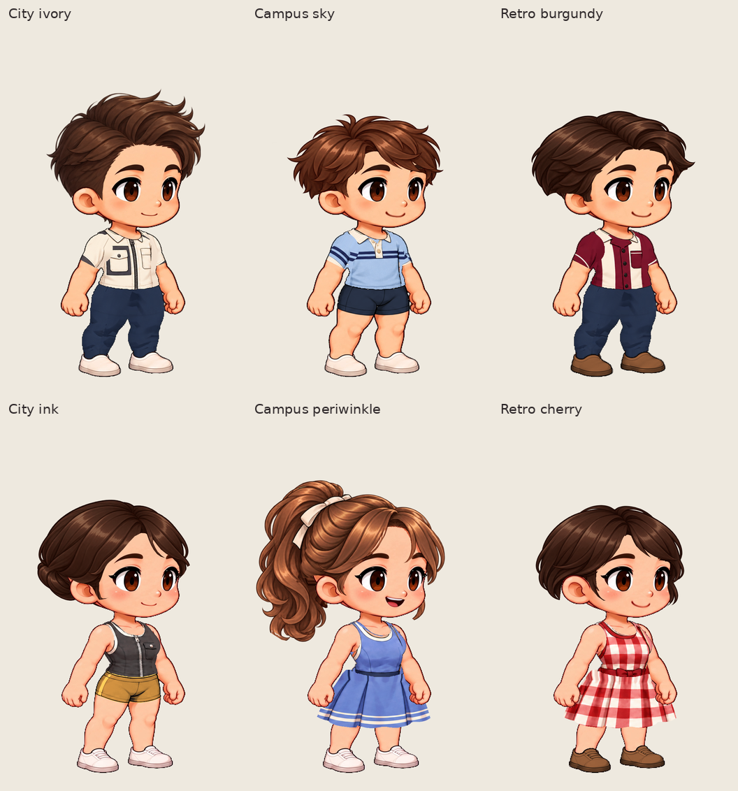

# City, campus and retro fashion

Six new painted garments and coordinated looks for the approved Kling characters: three styles, each with a male and female outfit. New clothing uses the reviewed source-pose cuts; the existing faces, proportions, motion clock and earlier wardrobe assets stay reproducible.

Open the library, choose **Dress Kling male / female**, and select the outfit under **Recommended** or search its name. Outfit buttons change clothing only and preserve the current hair and face. These are the complete styling recipes:

| Style | Outfit | New clothing | Existing hair / color | Face |
| --- | --- | --- | --- | --- |
| Urban | Male · City ivory | Ivory utility zip shirt, framed pocket | Swept quiff / Espresso | Natural |
| Urban | Female · City ink | Charcoal utility zip top, ivory binding | Tucked bun / Espresso | Natural |
| Campus | Male · Campus sky | Sky-blue knit polo, broad navy stripes | Soft crop / Chestnut | Gentle smile (refined) |
| Campus | Female · Campus periwinkle | Periwinkle A-line dress, twin ivory piping | Ribbon pony / Chestnut | Joyful (soft motion) |
| Retro | Male · Retro burgundy | Burgundy bowling shirt, ivory vertical panels | Side part / Espresso | Gentle smile (refined) |
| Retro | Female · Retro cherry | Large cherry gingham dress, compact waist bow | Soft bob / Espresso | Gentle smile (refined) |

City ivory uses existing navy suit trousers and white shoes; City ink uses ochre shorts and white shoes. Campus sky uses navy shorts. Retro burgundy uses navy suit trousers and brown shoes, and Retro cherry uses brown shoes. Exact IDs and source-bound selections are in [looks.json](../../../artwork/kling-collection/source/city-fashion-v1/looks.json). Existing hairstyles and expressions are reused; these are six new clothes, not six new heads.

## Artwork and fitting

OpenAI image generation supplies the new clothing detail. The donor sheets' generated anatomy and footwear are discarded. [Source artwork, prompts, traces and processing](../../../artwork/kling-collection/source/city-fashion-v1/README.md) are retained separately from actual application exports. Browser composition remains local and deterministic.

The three male tops retain the exact Teal V5 ownership and alpha across 88 poses each. City ink retains the repaired Plum V1 top contract across 96 poses. The two female dresses retain Coral V9 across 96 poses each. The separate top has its own bodice sampler and can mix with existing bottoms; it does not occupy the full-body dress slot.

The polo's chest stripes were extended through bounded cloth-only sampling padding after the first fitting exposed abrupt side stops. The cherry donor's large bow was reduced in a second image-generation edit. Dress fitting reuses the reviewed waist-overlap and hem processing. No old wardrobe bank or source frame is regenerated.

## Actual application exports

The [review gallery](review/index.html) links the original application downloads, native face crops, complete run-frame contact sheets and independent packs. The overview and GIF boards are presentation arrangements of real exports, not the generated donor sheets.

| Animation | Male trio | Female trio |
| --- | --- | --- |
| Run right | [GIF](review/male-three-looks-run-right.gif) | [GIF](review/female-three-looks-run-right.gif) |
| Run left | [GIF](review/male-three-looks-run-left.gif) | [GIF](review/female-three-looks-run-left.gif) |
| Jump right | [GIF](review/male-three-looks-jump-right.gif) | [GIF](review/female-three-looks-jump-right.gif) |
| Every run frame | [PNG](review/male-complete-run-frames.png) | [PNG](review/female-complete-run-frames.png) |

The compact boards use a shared presentation palette while retaining the downloaded GIFs' frame order, durations and loop behavior. Unmodified 384 × 592 GIF downloads are linked in the gallery. GIFs use the application's opaque preview matte; native PNGs and CharacterPacks retain their original alpha and resolution. Jump is a one-shot action, not a forced looping animation.

| Outfit | Independent CharacterPack |
| --- | --- |
| City ivory | [ZIP](evidence/final-male-v1/male-city-ivory.character.zip) |
| Campus sky | [ZIP](evidence/final-male-v1/male-campus-sky.character.zip) |
| Retro burgundy | [ZIP](evidence/final-male-v1/male-retro-burgundy.character.zip) |
| City ink | [ZIP](evidence/final-female-v1/female-city-ink.character.zip) |
| Campus periwinkle | [ZIP](evidence/final-female-v1/female-campus-periwinkle.character.zip) |
| Retro cherry | [ZIP](evidence/final-female-v1/female-retro-cherry.character.zip) |

Load a pack through **Player → Choose character pack**. Each includes idle, walk, run, jump and celebrate with both directions. To keep editing clothes, use the wardrobe recipe and **Save wardrobe**; baked playback packs are not editable clothing inventories.

## Verification for this batch

[Implementation checks](implementation-checks.json) record the newly executed TypeScript/production build, 58 related unit tests and the recommendation-browser regression. The independent [asset audit](asset-validation.json) covers six banks and all 552 clothing poses. All 47 earlier preview rows, 94 preview PNGs and earlier catalog entries were retained.

The [combined evidence index](evidence/combined-v1/evidence-index.json) references two actual production captures, [male](evidence/final-male-v1/evidence-index.json) and [female](evidence/final-female-v1/evidence-index.json), from implementation commit `e1c8fd2`. They contain 36 canonical PNG downloads, six mixed-outfit PNGs, 18 action GIFs and six CharacterPacks. All six saved projects reopened exactly and their source poses were independently reconstructed and compared pixel-for-pixel against the baked packs before the redundant temporary project ZIPs were removed. Six mixed outfits restored their original RGBA exactly; City ink specifically switches from ochre to navy shorts and back to check its separate-top waist.

Each capture closed its own editor contexts before testing its packs in independent player contexts. The two captures ran in parallel, so their closure timestamps are recorded separately; there is no claim that all editors globally closed before every player check. All **60 player cases** passed: six outfits × five actions × two directions. Looping actions repeated; one-shot actions reached their final frame and stopped. Neither run recorded external requests or editor-module loads by its independent player.

The [artifact audit](artifact-validation.json) independently decodes the retained exports and checks their provenance, native pixels, frame inventory, timing, transparency and exact left/right mirroring. [Gallery provenance](review/review-index.json) records how the review boards derive from those exports. These are this batch's executions, not historical counts.

Visual inspection covered each look's actual native standing/running/raised-arm/crouch exports and full run-frame sheets, plus both shorts combinations for City ink. No new donor-skin strips or detached cloth islands were found in the reviewed samples. The six designs remain distinguishable at presentation size. Known material/geometry limits below remain visible rather than being excluded from the delivered poses.

## Review limits

- New details use established short-sleeve and sleeveless cuts. They do not add new garment silhouettes or cloth physics.
- The existing female V9 waist-side contour remains raised in some deep crouches. Large gingham makes compression in those poses more noticeable; the collection does not replace the approved body or skirt geometry to conceal it.
- Campus sky's sleeve/body stripes have a small alignment discontinuity at their material boundary. The large navy sleeve block from the first fitting was corrected; the remaining offset is not an alpha gap.
- Female deep crouches retain an angular compressed waistband and a short dark cloth edge beneath it. The original neckline/strap fitting and source motion blur remain visible.
- Original motion blur and some protected neckline remnants remain. Existing trouser shading is broader than the new shirt detail.
- Outfit selection preserves hair and face. A baked CharacterPack supports independent playback; use **Save wardrobe** to retain an editable clothing project.
- Technical validation and visual review are separate. This collection is delivered for review, without assuming the user's visual acceptance.
