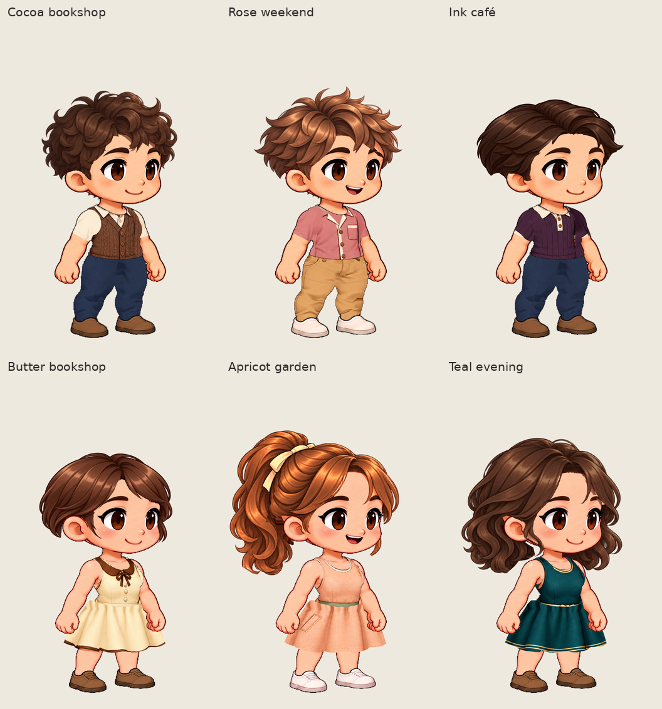

# Warm daily and refined date collection

Six new painted garments for the original Kling male/female characters, with coordinated existing hairstyles and expressions. Their faces, proportions, source frames and five-action timing remain unchanged by clothing authoring. These are additive, source-bound cloth drawings on reviewed cuts; earlier garments, appearance banks and saved projects remain available.

Open the character library, choose **Dress Kling male / female**, and select a new recommended outfit or search its name. Outfit buttons change clothing only, preserving the current hair and expression. Use these settings to reproduce the complete looks:

| Character | Outfit | New clothing | Hair / color | Face |
| --- | --- | --- | --- | --- |
| Male | Cocoa bookshop | Cocoa cable-knit vest over ivory short sleeves | Soft curls / Espresso | Gentle smile (refined) |
| Male | Rose weekend | Dusty-rose camp shirt with patch pocket | Airy tousle / Chestnut | Joyful (soft motion) |
| Male | Ink café | Deep-plum knit polo with cream tipping | Side part / Espresso | Gentle smile (refined) |
| Female | Butter bookshop | Buttercream dress, cocoa collar/bow and edged hem | Soft bob / Chestnut | Gentle smile (refined) |
| Female | Apricot garden | Apricot pocket dress with sage waistband | Ribbon pony / Copper | Joyful (soft motion) |
| Female | Teal evening | Deep-teal dress with gold waist and hem details | Romantic waves / Espresso | Gentle smile (refined) |

Exact selections are recorded in [looks.json](../../../artwork/kling-collection/source/warm-date-v1/looks.json). Existing trousers and shoes complete the outfits; the new artwork does not replace those pieces. The matching hairstyles/expressions are existing released assets, not newly generated heads.

## Artwork and fitting

Two OpenAI-generated donor sheets supply new clothing detail, not final exported characters. Generated anatomy, trousers, shoes and backdrop are discarded. [Sources, prompts and processing](../../../artwork/kling-collection/source/warm-date-v1/README.md) are retained. Runtime composition remains local and deterministic, with no image-generation requests.

The male bank retains every reviewed Teal V5 ownership/alpha pixel across 88 source poses. Female dresses retain Coral V9 ownership/alpha across 96 source poses. Explicit cloth-only traces avoid sampling donor skin. New designs are fitted in RGB while source positions and occlusion remain fixed.

During review, the cocoa vest's flat side padding was replaced by continuation of its painted knit. A pale rose shoulder fragment was excluded from the donor trace. Female skirt folds were extended through the fixed waist overlap, belt artwork was restricted to the bodice, and the butter dress's dark trim was registered to the reviewed hem.

## Actual exported characters

The [review gallery](review/index.html) includes all source downloads and complete run-frame contact sheets. These are application exports, separate from the donor sheets and offline authoring prototypes.

| Review | Male | Female |
| --- | --- | --- |
| Three looks, run right | [GIF](review/male-three-looks-run-right.gif) | [GIF](review/female-three-looks-run-right.gif) |
| Three looks, run left | [GIF](review/male-three-looks-run-left.gif) | [GIF](review/female-three-looks-run-left.gif) |
| Three looks, jump | [GIF](review/male-three-looks-jump-right.gif) | [GIF](review/female-three-looks-jump-right.gif) |
| Every run frame | [PNG](review/male-complete-run-frames.png) | [PNG](review/female-complete-run-frames.png) |

Review GIF boards arrange the actual downloaded GIFs, with a compact shared presentation palette. They preserve frame order, duration and looping; the original 384 × 592 GIF bytes remain linked in the gallery. Jump is a one-shot action. Native PNGs and CharacterPacks retain their original resolution and alpha.

| Complete character | Independent CharacterPack |
| --- | --- |
| Cocoa bookshop | [ZIP](evidence/final-v1/male-cocoa-bookshop.character.zip) |
| Rose weekend | [ZIP](evidence/final-v1/male-rose-weekend.character.zip) |
| Ink café | [ZIP](evidence/final-v1/male-ink-cafe.character.zip) |
| Butter bookshop | [ZIP](evidence/final-v1/female-butter-bookshop.character.zip) |
| Apricot garden | [ZIP](evidence/final-v1/female-apricot-garden.character.zip) |
| Teal evening | [ZIP](evidence/final-v1/female-teal-evening.character.zip) |

Load a pack in **Player → Choose character pack**. Each contains idle, walk, run, jump and celebrate, with both facing directions. To edit the clothing, use the wardrobe recipe above and **Save wardrobe**; the baked player packs do not contain an editable outfit inventory.

## This batch's verification

[Implementation checks](implementation-checks.json) record the newly executed production build, 58 related unit tests and one recommendation-browser regression. The [asset audit](asset-validation.json) covers all six new garment banks and 552 clothing-pose instances. All 41 earlier preview rows, 82 preview PNGs and existing catalog entries were retained.

The [production capture index](evidence/final-v1/evidence-index.json) records 42 PNG downloads (36 canonical and six mixed outfits), 18 action GIFs, six CharacterPacks, six exact save/reopen checks and six exact mix/restoration checks. Each temporarily saved editable project was independently reconstructed across every source pose and compared pixel-for-pixel to its baked pack before the redundant project download was removed.

After all editor contexts were closed, all **60 independent-player cases** passed: six characters × five actions × two directions. Looping actions were observed across repeated cycles; one-shot actions reached their final frame and stopped. The capture served the production build and recorded no external network requests or editor-module requests from the independent player.

Final independent artifact decoding and player checks are recorded in [artifact-validation.json](artifact-validation.json); the gallery provenance is in [review-index.json](review/review-index.json). These are this batch's runs, not historical test counts. Visual assessment and the technical audits are separate.

Visual review covered the actual six-look overview, native face crops, individual native stills and every run frame for each look, supplemented by the difficult-pose authoring sheets. The six collar/pocket/knit/trim designs remain identifiable at preview size. The new donor clothing does not introduce visible skin/backdrop fragments in these reviewed poses. Waist and hem sampling are improved over the first donor fit. This is a reviewable collection, not a claim that all inherited motion, face or silhouette limitations have been solved.

## Limits

- These six designs use the existing short-sleeve and sleeveless A-line silhouettes. They add construction detail, not new sleeve geometry or cloth physics.
- The fixed female V9 upper skirt contour can still look raised at the waist in deep crouches; the original blurred jump frames and some protected neckline remnants remain.
- Existing trousers have broader, flatter shading than the new knit cloth. They were reused without repainting in this collection.
- Clothing selection intentionally preserves the current face and hair. Complete rendered CharacterPacks are for independent playback; use the wardrobe and the recipe above to keep editing.
- Passing technical checks does not constitute the user's visual acceptance.
