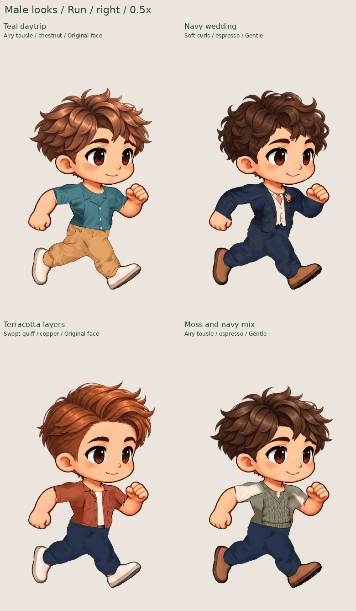
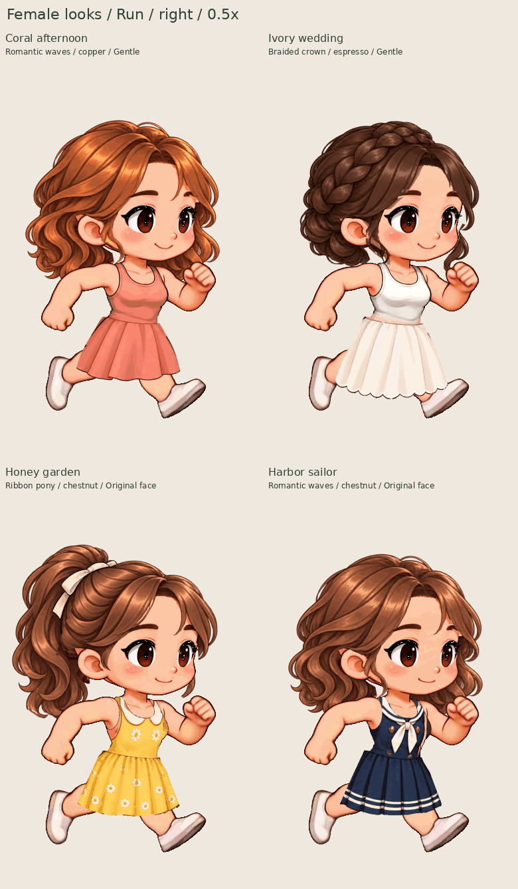

# 最近功能与 8 组实际换装预览

本页基于 `784ac69` 的真实生产应用导出，使用当前两个人物、已有服装和发型重新搭配。
最新的三件服装修订和候选预览功能位于 **PR #38（待合并）**；此前的功能已随 PR #37 及更早批次合入。
这次只制作展示与验证材料，没有修改应用渲染器、人物素材或动作。

## 最近已经做好的功能

| 功能             | 当前可以做什么                                                                                                                                                             |
| ---------------- | -------------------------------------------------------------------------------------------------------------------------------------------------------------------------- |
| 服装与混搭       | 日常、婚礼和扩展系列；分别选择上衣、下装、鞋子，连衣裙作为全身服装；按人物原动作逐帧注册和处理遮挡。                                                                       |
| 发型与基础面部   | 六款蓬松发型：Airy tousle、Soft curls、Swept quiff、Romantic waves、Ribbon pony、Braided crown；栗棕、深咖、铜棕三种发色；原始与 Gentle 面部预设，保留源动作的眨眼和笑脸。 |
| 选择、保存与恢复 | 服装图片卡片、搜索与历史版本；每个人物最多 12 个已保存造型；完整素材随可编辑项目保存；撤销/重做造型不打乱当前动作。                                                        |
| 动作与导出       | 站立、走路、跑步、一次性跳跃、庆祝；左右播放、逐帧查看、预览速度；透明 PNG、动作 GIF、可编辑项目和独立 CharacterPack。                                                     |
| 对比与审阅       | 固定当前造型作参照；同帧并排、叠加、差异、轮廓和关节局部检查；扫描整段动作、记录问题、导出带哈希的备注和联系表。                                                           |
| 新素材试穿       | 导入服装先单独预览，明确应用或丢弃；应用后可撤销；检查素材来源、锚点、全部姿势和旧造型是否变化，防止错误覆盖。此项在 PR #38。                                              |
| 局部修复         | 多轮处理袖口、前臂遮挡、下蹲腰线、裙摆和耳发交界；最新青绿衬衫与两套裙装修订为可选新版本，不替换旧存档。最新三件在 PR #38。                                                |
| 加载与管理       | 后台准备、可取消加载、受限缓存和未引用素材清理；相同输入的审阅导出复用已完成扫描。                                                                                         |

独立骨骼工具仍保留四个静态姿势和关节调整。当前换装动画使用人物自己的精灵帧；骨骼工具没有被描述为完整连续动画系统。
面部仍是预设选择，自由捏脸尚未完成；新衣服仍需完整的已注册动作素材，单张站姿图不能直接覆盖所有姿势。

## 先看同步跑步总览

每张 GIF 中四个人物使用相同动作位置和原始节奏，方便直接比较搭配。

**男版：**

**女版：**

[八种组合站姿总览](review/eight-looks.png)

## 单独看五种动作

| 男版                                                                        | 女版                                                                 |
| --------------------------------------------------------------------------- | -------------------------------------------------------------------- |
| [青绿日常：蓬松短发／栗棕](review/male-teal-five-actions.gif)               | [珊瑚日常裙：长卷发／铜棕](review/female-coral-five-actions.gif)     |
| [深蓝礼服：短卷发／深咖](review/male-wedding-five-actions.gif)              | [象牙白婚礼裙：编发／深咖](review/female-wedding-five-actions.gif)   |
| [陶土色叠穿：上梳发／铜棕](review/male-terracotta-five-actions.gif)         | [蜂蜜黄花园裙：丝带马尾／栗棕](review/female-honey-five-actions.gif) |
| [苔绿针织＋深蓝长裤：蓬松短发／深咖](review/male-moss-mix-five-actions.gif) | [海军风连衣裙：长卷发／栗棕](review/female-sailor-five-actions.gif)  |

五动作展示顺序是 **站立 → 走路 → 跑步 → 跳跃 → 庆祝**。为了看清动作，站立、走路、庆祝各播放两轮，跑步三轮，跳跃一次。
这是带标签的展示拼接，没有生成动作间的新过渡，也没有改动动作内部速度。原始跳跃 GIF 仍是一次性播放。
人物使用应用 GIF 的原有半尺寸画面；只增加文字和排列，没有裁掉头发、鞋子或进行逐帧居中。

[原始动作 GIF（48 个，含左右跑步）](actions) · [原生透明 PNG](frames) · [精确搭配配置](cases.json)

## 本次验证与可复现性

[应用导出记录](capture.json) · [逐帧验证与展示来源](validation.json)

本次结果：8 组搭配全部完成；8 个临时角色包共 736 个原生姿势可解码，40 张透明 PNG 与包内像素完全一致；
48 个原始 GIF 的 1,104 帧通过帧序、时长和循环检查，8 组左右跑步逐帧镜像一致。
另外生成并再次解码 10 个展示 GIF（8 个五动作展示、2 个跑步总览）。没有应用运行错误、失败请求或外部网络请求。

本次重新运行生产应用，逐组选择服装、发型、发色和面部，然后直接下载 GIF、PNG 以及供验证使用的 CharacterPack。
验证包含帧序、时长、循环标志、完整解码、PNG 与角色包像素一致、GIF 与角色包的量化误差、左右跑步逐帧镜像。
展示 GIF 再次解码，检查时间总长及每个停留区间的画面，允许编码器合并相同的连续帧。

临时 CharacterPack 位于 `.review-tmp/kling-combination-gallery`，不重复提交大文件；哈希和元数据保留在导出记录中。
需要复跑完整审计时，先重新捕获这些临时包。用户直接查看 GIF 不需要任何角色包或编辑器。
本次没有重新执行上一批的 309 项单元测试和 76 项浏览器回归；那些结果记录在上一批交付中。

运行 `scripts/capture-kling-combinations.mjs`，随后运行 `scripts/render-kling-combinations.py` 可重新制作。
捕获使用已有生产构建，须先执行 `npm run build`；两条命令使用相同的 `KLING_GALLERY_DIR` 新目录，捕获另可用 `KLING_GALLERY_TEMP` 指定临时包目录。
需要 Chromium、Pillow、NumPy 与 DejaVu 字体。已完成的捕获和验证文件不会被覆盖。

当前仍能看到个别耳发边缘、袖肩和大幅下蹲时的拼接感；头发随头部注册，没有独立发束物理。
这些 GIF 如实展示现有结果，功能检查通过不等于最终美术验收。
