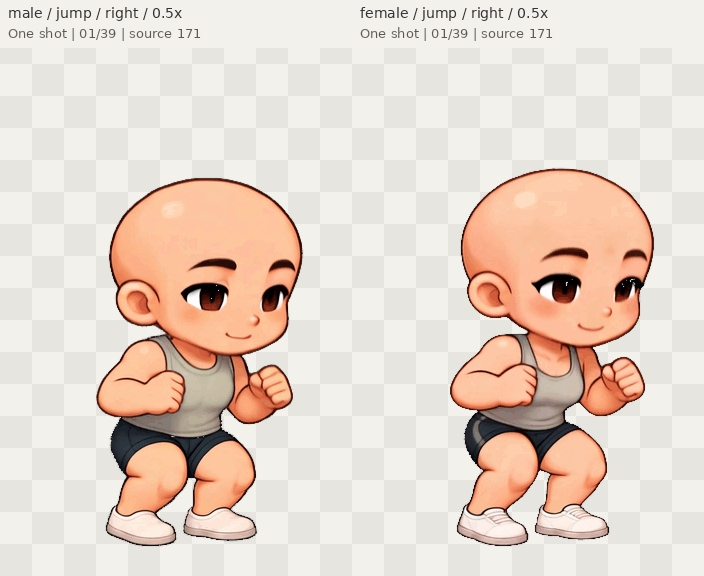

# Original Kling characters — now with Jump

> Historical source/artwork delivery record. For the current Kling-only workspace,
> supported files and fresh checks, see [the cleanup review](../KLING_FOCUS_REVIEW.md).
> Unrelated legacy editor/CharacterPack V1 compatibility described below was
> intentionally removed; the Kling sources and exports remain unchanged.

Open `/player.html` after `npm run dev`, click **Try the Kling character pair**,
then choose **Jump**. It plays once, holds the landing/recovery pose, and offers
**Replay**. Both characters retain Idle, Walk, Run and Celebrate, left/right
mirroring, pause and frame scrubbing. Downloaded packs work independently.

These previews come from actual player exports. Original source frame pixels,
proportions and the 24 fps timing are retained. This is baked video playback,
not a new drawing or skeletal reconstruction.

| Character | Jump right                          | Jump left                          | Portable five-action pack           |
| --------- | ----------------------------------- | ---------------------------------- | ----------------------------------- |
| Male      | [GIF](review/male_jump_right.gif)   | [GIF](review/male_jump_left.gif)   | [ZIP](exports/male.character.zip)   |
| Female    | [GIF](review/female_jump_right.gif) | [GIF](review/female_jump_left.gif) | [ZIP](exports/female.character.zip) |

GIFs are reduced, palette-based review copies of all 39 original jump frames.
They play once and hold the last frame; reopen the image to replay. GIF timing
is rounded to its 10 ms clock. Native packs retain exact 24 fps, 1.625-second timing.
Use the player at 1× for native image inspection.

- Male key poses: [native](review/male_jump_keyframes_1x.png), [2×](review/male_jump_keyframes_2x.png).
- Female key poses: [native](review/female_jump_keyframes_1x.png), [2×](review/female_jump_keyframes_2x.png).
- Original video → matte → actual exported apex: [male](review/male_apex_source_matte_export_1x.png), [female](review/female_apex_source_matte_export_1x.png).
- Actual player: [paired apex](browser/pair-jump-apex.png), [paired recovery](browser/pair-jump-recovery.png).
- [Browser checks](browser/evidence-index.json), [decoded media checks](artifact-validation.json), [current verification](verification-results.json).
- [Implementation, compatibility and limitations](../KLING_JUMP_REVIEW.md).

The original videos slightly cut the scalp at the apex (source frames 183–186).
A uniform transparent top extension prevents additional crop loss, but does
not invent those missing pixels. Source motion blur and the pose change back
to idle remain visible. Native imports and two-character playback are still
memory-intensive (the measured first pair import took about 58 seconds); use an
individual downloaded pack for quicker review.

The new ZIPs use explicit **CharacterPack V3** with two PNG pages per character.
Keep the complete ZIP together and use the updated player. V1/V2 saved packs
continue to load; old packs without jump still clearly mark it unavailable.
[Historical four-action source and exports](../kling-playback/README.md) remain
available unchanged.
