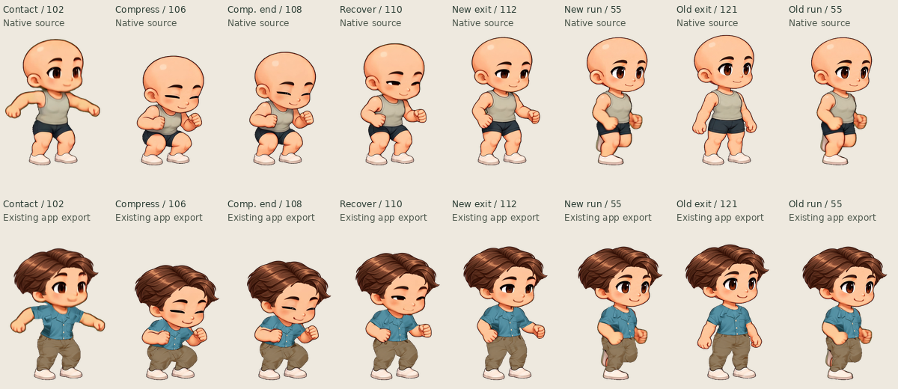
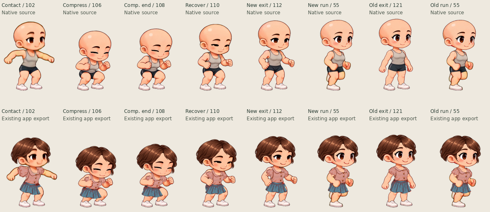
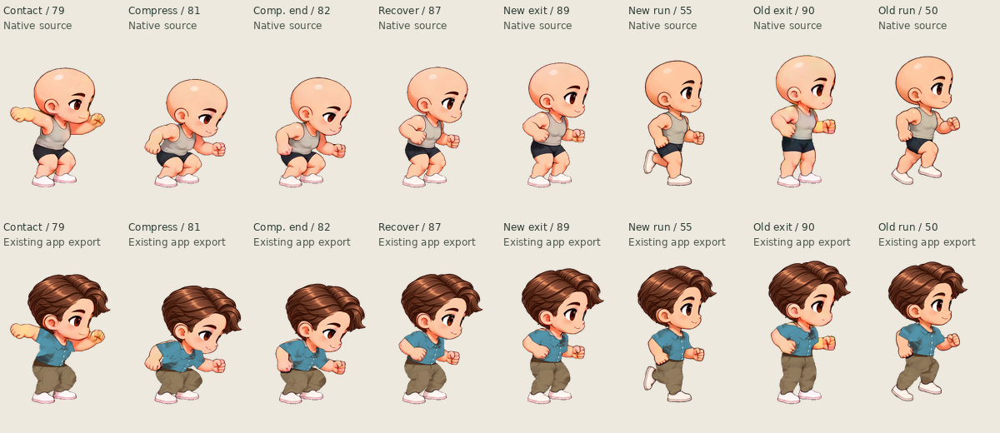
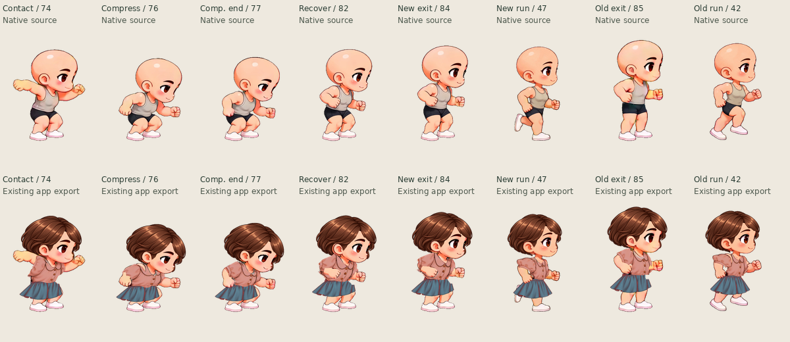

# Landing → running: source-pose review

The previous Jump → Run routes waited for every frame of the standalone jump. In the original view that includes returning almost to idle, lowering the arms, and then raising them again when running resumes. The side view has a different problem: its last grounded drawing was preparing the source video's second takeoff, and the old run entry changes immediately to a forward stride.

This review selects an earlier **running-specific** boundary and a supported running pose from the existing frames. Standalone Jump, Jump → Idle, and Jump → Walk retain their complete clips. The new boundary is used only when running has been requested in time; a late request retains the full-clip fallback.

## Reviewed routes

`exitFrame` is the boundary after that many jump playback ticks. `entryFrame` is a **zero-based** index in the run sequence. Native IDs identify atlas drawings and must not be substituted for either index.

| Character / view  | First contact | Full compression retained | Earlier run route                   | Full-clip fallback                  |
| ----------------- | ------------- | ------------------------- | ----------------------------------- | ----------------------------------- |
| Male / original   | 102           | 103–108                   | After ID112: exit30 → entry4 / ID55 | After ID121: exit39 → entry4 / ID55 |
| Female / original | 102           | 103–108                   | After ID112: exit30 → entry4 / ID55 | After ID121: exit39 → entry4 / ID55 |
| Male / side       | 79            | 80–82                     | After ID89: exit27 → entry16 / ID55 | After ID90: exit28 → entry11 / ID50 |
| Female / side     | 74            | 75–77                     | After ID84: exit27 → entry13 / ID47 | After ID85: exit28 → entry8 / ID42  |

All airborne drawings and the complete landing compression remain. Source ticks still last 1/24 second. There is no animation speed-up, redraw, interpolation, crossfade, position correction, or alteration to source pixels.

## Why these boundaries

**Original view.** IDs103–108 absorb the landing; IDs109–112 recover to a useful running height while the arms are still bent. IDs114–121 settle nearly upright and lower the arms toward idle. Waiting through that tail creates a visible stop-and-restart. ID112 → Run55 preserves the bent arms and enters a grounded passing pose. The native silhouette top changes by only 2 px for the male and 6 px for the female, on a 1184 px canvas.

ID111 was also checked. It is more crouched, and its silhouette top differs from Run55 by 14 / 24 px. ID112 was chosen to retain one more useful recovery drawing rather than cutting at the earliest possible frame.

**Side view.** Most of the recovery is necessary. Cutting immediately after compression, at male82 / female77, would abruptly lift the head by about 60 px into a run pose. Keep the recovery through male89 / female84 instead. The following male90 / female85 drawing lifts the silhouette by another 27 / 28 px and was preparing the next source-video takeoff. The earlier exit avoids that extra lift and enters the lower grounded passing pose Run55 / Run47. The new boundary changes the native silhouette top by 8 / 5 px and avoids the old wide forward-stride entry.

For the side male, the old last-frame-to-run height difference was already small (3 px). The improvement is the surrounding motion and supported leg pose, **not** a claim that every individual pixel-distance score is smaller. Alpha bounds support the inspection; they cannot by themselves prove joint or foot continuity.

## Timing impact

The following interval starts when the first ground-contact frame is displayed and ends when the first run frame is displayed. It includes compression and recovery; it is not an assertion that every tick is an idle hold.

| View, both characters | Previous interval   | Reviewed interval   | Removed tail     |
| --------------------- | ------------------- | ------------------- | ---------------- |
| Original              | 20 ticks / 833.3 ms | 11 ticks / 458.3 ms | 9 ticks / 375 ms |
| Side                  | 12 ticks / 500 ms   | 11 ticks / 458.3 ms | 1 tick / 41.7 ms |

The side change primarily improves the exit/entry poses. It does not remove half a second of necessary grounding or pretend that the source has an immediate running landing. The full standalone jump remains 39 ticks (original) or 28 ticks (side).

## Evidence and limits

[selection.json](selection.json) records the source-archive SHA-256, exact phase boundaries, route indices, timing, alpha bounds, and decoded RGBA hashes for the illustrated drawings. The source archives are the same ones reviewed for [single-jump selection](../kling-single-jump/selection.md). The composition row uses actual CharacterPack exports from that previous review, so the pose choice was checked with clothing and matched hair as well as the base character.

Each sheet uses one fixed crop and uniform scale across every cell. Top row: native source. Bottom row: existing composed app export. These are inspection previews, not replacement artwork or a claim that the new playback has already passed UI/export verification.

The clips still come from separate recorded actions. Differences in arm position, body lean, shading, and the change from two-foot landing support to running support remain. This review identifies safer existing drawings; it does not establish perfect seamlessness. Late run requests may still use the longer recovery route. Walk was deliberately left unchanged because its entry poses have not received the same targeted visual review. Actual exported GIFs and independent-player behavior require a separate verification pass.
