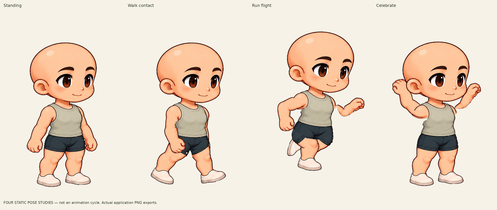

# Native Kling male skeletal candidate

Start the app with `npm ci` and `npm run dev`, then open
`/workbench.html?mode=rig&study=kling-male` or
`/skin-studio.html?study=kling-male`. The library also links the candidate.
Original playback remains available; this is now the only skeletal workspace.

This is the **original male standing artwork**, partitioned into fifteen native
parts, plus disclosed hidden joint coverage. Standing is RGBA-identical to the
approved source. Walk contact, run flight and celebration are **static skeletal
pose studies**, not completed motion cycles.

## Retained actual app exports

These screenshots/exports document the candidate before cleanup; current
workflow screenshots and checks are linked in the cleanup review. Artwork is
unchanged. Historical records retain the inputs and test counts of their run.

- [Original vs layered reconstruction, 1×](final/review/source-reconstruction-1x.png)
  · [2×](final/review/source-reconstruction-2x.png)
- [Four poses, 1×](final/review/four-poses-right-1x.png)
  · [2×](final/review/four-poses-right-2x.png)
- [Joint details, 2×](final/review/joints-2x.png)
- [First iteration vs final joints, 2×](final/review/joint-iteration-comparison-2x.png)
- [Fifteen registered parts](final/review/registered-parts.png)
- [Actual authoring UI](final/ui-standing.png)
  · [Independent player after the editor was closed](final/independent-player.png)
- [Download the actual exported editable project](final/kling-male-native-study.project.zip)
- [Download the static-pose CharacterPack](final/kling-male-native-stills.character.zip)
- [Actual browser/export verification](final/evidence-index.json)
- [PNG and ZIP validation](final/artifact-validation.json)
- [Current cleanup verification](../KLING_FOCUS_REVIEW.md)
- [Historical candidate verification](https://github.com/hanxuwu/gathria-character/blob/158efad/docs/kling-native-study/verification-results.json)

The `initial` folder preserves the first actual UI export for comparison.
Its capture overlapped development and is explicitly **not final validation**.
`iterations/workflow-check` is a workflow precheck captured during asset changes;
its unchanged-input guard intentionally fails. Only `final` is the frozen-input
delivery. Final validation includes closing the authoring page before opening
the candidate CharacterPack in the independent player.

## Source, editable project and scope

- [Exact transparent reference PNG](../../artwork/kling-native-study/source/reference.png)
- [Fifteen transparent HD parts](../../artwork/kling-native-study/prepared/parts)
- [Registered joints, parents, draw order and poses](../../artwork/kling-native-study/prepared/registration.json)
- [Portable editable native project](../../artwork/kling-native-study/prepared/project.zip)
- [Source/prompt and newly authored hidden coverage](../../artwork/kling-native-study/source/README.md)
- [Implementation, compatibility and visual limitations](../KLING_NATIVE_STUDY_REVIEW.md)

Open the native project with **Open native project** in this candidate UI.
It is a versioned native study, not a legacy 192×256 Skin V1 file. Use the
separate CharacterPack in the independent player; it contains four one-frame
holds with `loop:false`, including celebration and no jump.

Current limits include near-armhole notches, rounded/compressed raised shoulders
and angular shorts folds under deep bends; the far upper arm narrows beside the
vest in run flight. Expression and clothing are fixed;
complete animation, independent wrist control, female registration and wardrobe
items remain later work. Technical correctness does not imply final visual
acceptance.
