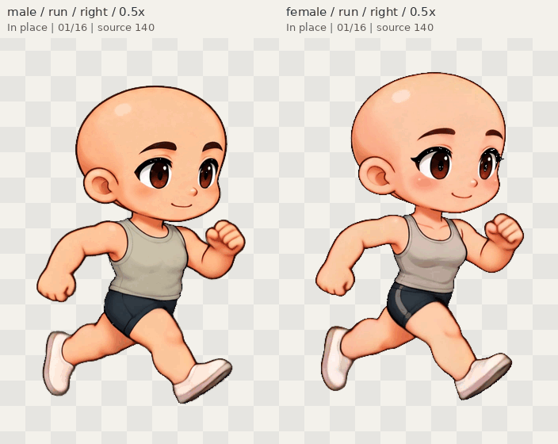

# Original Kling characters — review

These pictures come from the actual player's exported CharacterPacks. They
retain the source video figures; there is no newly drawn or skeletal stand-in.
Open `/player.html` after `npm run dev`, then choose **Try the Kling character pair**.
For quick independent playback, upload either exported pack below.

If an older build reports `Cannot read properties of undefined (reading 'digest')`,
its source importer assumes Web Crypto is available. Browsers usually hide
`crypto.subtle` on ordinary HTTP LAN addresses (localhost and HTTPS differ).
The HTTP compatibility fix uses the same SHA-256 fingerprints through a local
JavaScript fallback; it does not skip validation or change artwork. Update the
player build, or load one of the exported CharacterPacks below directly in the
older player. See [HTTP verification](http-fix/README.md).

## Native sources and portable packs

- [Male CharacterPack V2](exports/male.character.zip)
- [Female CharacterPack V2](exports/female.character.zip)
- [Both characters' importable source ZIP](../../artwork/kling-playback/prepared/kling-source.zip)
- [Male: source video → matte → actual export, 1×](review/male_source_matte_export_1x.png)
- [Female: source video → matte → actual export, 1×](review/female_source_matte_export_1x.png)
- [Male face/neck at 2×](review/male_face_neck_2x.png) · [Female face/neck at 2×](review/female_face_neck_2x.png)
- [Actual male native player display](browser/male-native-canvas.png) · [Female](browser/female-native-canvas.png)

Each pack stores 83 original frames at **704×1024, 24 fps**. The source matting
estimates transparent edge colors; fully opaque RGB is unchanged. After matting,
import/export/reimport preserves all RGBA bytes. The bodies, vest, shorts, shoes
and expressions are baked together; these are not editable wardrobe skins.

## Animation previews

GIFs are **0.5× display copies with 256-color palettes**. Their frame delays are
rounded to GIF's 10 ms clock; exported packs retain exact 24 fps timing. All
previews play in place; the source's body turns and motion blur are retained.

| Action | Male | Female | Shared-clock comparison |
| --- | --- | --- | --- |
| Idle | [GIF](review/male_idle.gif) | [GIF](review/female_idle.gif) | [Pair](review/pair_idle.gif) |
| Walk | [GIF](review/male_walk.gif) | [GIF](review/female_walk.gif) | [Pair](review/pair_walk.gif) |
| Run | [GIF](review/male_run.gif) | [GIF](review/female_run.gif) | [Pair](review/pair_run.gif) |
| Celebrate | [GIF](review/male_celebrate.gif) | [GIF](review/female_celebrate.gif) | [Pair](review/pair_celebrate.gif) |

[Male run left](review/male_run_left.gif) · [Female run left](review/female_run_left.gif).
Both directions of every action are exercised by the independent-player checks.

## Frame-by-frame inspection

| Action | Male native contact sheet | Female native contact sheet |
| --- | --- | --- |
| Idle | [1× PNG](review/male_idle_frames_1x.png) | [1× PNG](review/female_idle_frames_1x.png) |
| Walk | [1× PNG](review/male_walk_frames_1x.png) | [1× PNG](review/female_walk_frames_1x.png) |
| Run | [1× PNG](review/male_run_frames_1x.png) | [1× PNG](review/female_run_frames_1x.png) |
| Celebrate | [1× PNG](review/male_celebrate_frames_1x.png) | [1× PNG](review/female_celebrate_frames_1x.png) |

Every contact sheet includes source frame numbers. Smaller `*_frames_overview.png`
files and native `*_boundary_1x.png` last/first comparisons are in [review/](review/).
Light/dark native standing images expose the actual transparent edges.

## Verification and remaining work

- [Actual-browser and independent playback record](browser/evidence-index.json)
- [Separate original 384×576 source compatibility check](browser/legacy-source-check.json)
- [Decoded PNG/GIF/ZIP checks](artifact-validation.json)
- [Final verification results](verification-results.json)
- [Architecture, compatibility and test results](../KLING_PLAYBACK_REVIEW.md)
- [Source preparation and provenance](../../artwork/kling-playback/README.md)
- [Future modular conversion assessment](../KLING_MODULAR_FEASIBILITY.md)

The source run contains blurred hands/forearms/shoes, walk has slight cadence
variation, and idle is nearly static. Those are retained source limitations.
No unseen anatomy, garment layers or left-view artwork was invented. Initial
native import is heavy (about 42 seconds in the first Chromium run); pair view
holds two large decoded atlases. Native source fidelity is prioritized.

Technical checks do not constitute user visual acceptance. Full skeletal
conversion, independent clothing and production-scene integration remain later
work and must be compared against these untouched original performances.
