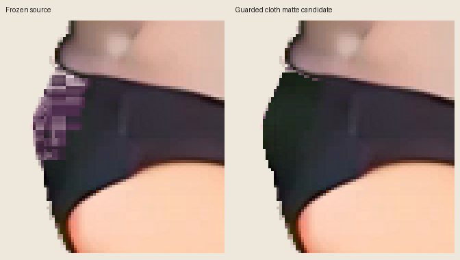
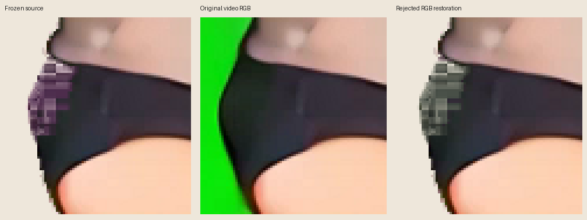
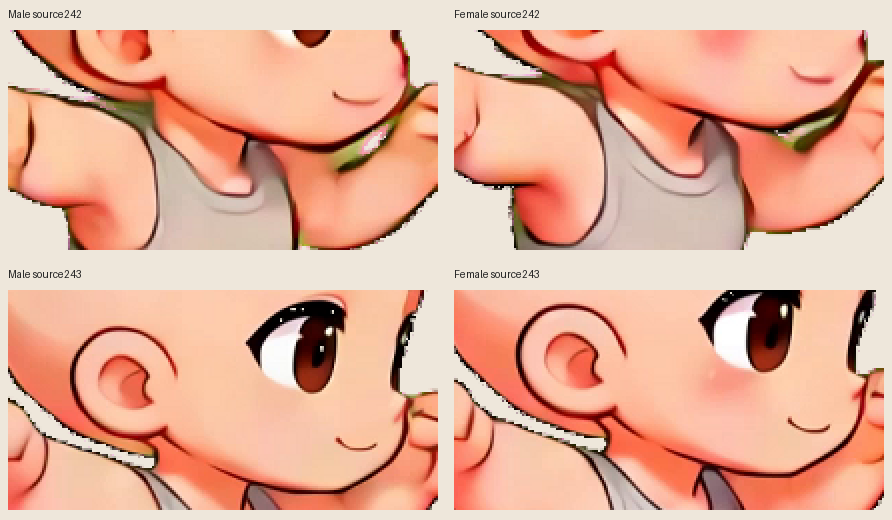

# Bounded source-quality audit

One optional cloth-interior cleanup candidate is ready for review; it is not
enabled. Frozen source ZIPs, extracted frames, body drawing, animation timing
and runtime assets remain unchanged. Candidate alpha differs only at the exact
502 declared shorts-interior pixels described below.



The [cloth matte candidate](../../../artwork/kling-side-expansion/cleanup/male-source242-cloth-matte-candidate.json)
restores original-video RGB and opaque alpha in the damaged male source242
shorts interior. It changes 498 RGB pixels and 502 alpha values in pack frame99,
inside native x178–203 / y444–479. Eligible source pixels must already have
nonzero, nonopaque alpha. Original registered RGB must be dark (all channels
below 85), with a two-native-pixel Manhattan guard from the edge of that dark
region. The supplied [binary mask crop](../../../artwork/kling-side-expansion/cleanup/male-source242-cloth-matte-mask.png)
is 26×36 at offset (178,444). The exact sparse coordinates are authoritative.

Native crop and full-frame inspection show a clear reduction of the blocky
purple fringe. The original nonzero-alpha footprint is exact, every pixel
outside the sparse coordinates is exact, and neither anatomy nor the outline
is redrawn. Small residual edge pixels outside the conservative mask remain.
This candidate is not a complete matte repair across the animation, and it
does not claim all 502 alpha values were correct in the frozen extraction.

The candidate is `optional-review-candidate-not-enabled` with
`defaultEnabled: false`. It records source video, decoded RGB, registration,
pack and frame hashes, exact before/after RGBA, declared region, alpha delta
totals and reversal instructions. No runtime integration is included here.

The male jump source242 purple outer-shorts fringe is extraction damage, not a
purple garment detail. The original `male-2360.mp4` frame242 has dark shorts in
the same region. The keyed frame also has partial-alpha holes through that
cloth. Restoring the original video RGB at the existing fixed registration
removes purple but makes the retained checkerboard alpha visible as gray/green
blocks. This is an unsuccessful RGB-only experiment, retained for review.



The experiment replaces exactly 470 RGB pixels in male pack frame99
(source242), inside native bounds x178–203 / y444–479. The selection requires
visible source alpha, red and blue each more than 8 above green, and all original
video RGB channels below 85. Every replacement comes from the original video
frame through the source's existing fixed registration. No colors are painted
or inferred from another pose. Every alpha byte remains exact, which is also
why this experiment cannot resolve the damaged silhouette transparency.

The [rejected sparse experiment](../../../artwork/kling-side-expansion/cleanup/male-source242-rejected-rgb-restoration.json)
contains exact coordinates, before/after RGBA, source pack/frame hashes and the
inverse operation. Its status is `rejected-do-not-enable`, and the
[audit](../../../artwork/kling-side-expansion/cleanup/audit.json) has
`acceptedPatches: []` alongside the separate `reviewCandidates` entry. Both
patches use an audit format, not a runtime garment format. A future consumer
must verify the exact pack and full frame hashes,
check every before pixel, then replace the specified pixels; ordinary alpha
compositing would be incorrect. Inversion verifies the candidate hash and each
after pixel before restoring the recorded original. No patch is auto-attached.

Male/female neck and raised-arm gaps retain green wedges, especially around
source241/242. The male original video already contains dark green shaded
background in those gaps, and the frozen extraction retains some opaque
pixels. Neutralizing green would leave false dark geometry. Correcting the
matte would require uncertain gap ownership, so no neck correction was attempted. Genuine skin,
clothing shadows and outline pixels were left intact.



Inspection covered half-size contacts of all 50 jump frames per character,
native male source240–244 shorts, native male/female source242–243 neck areas,
and original male video frame242. Contact inspection is not a claim that all
209 source frames received a full anatomical quality review. Neither the
rejected experiment nor this audit changes anatomy, poses, or shading across
action cuts.

Additional evidence:

- [Neighboring shorts poses](shorts-neighboring-poses.png)
- [Native frozen source and optional cloth matte candidate](male-source242-matte-native-before-after.png)
- [Native frozen source and rejected RGB-only experiment](male-source242-native-before-after.png)

Reproduce with Python/Pillow/NumPy and FFmpeg:

```sh
python scripts/prepare-kling-side-cleanup.py
```

Use `--output-root /tmp/cleanup-review` to reproduce outside the checkout.
The script verifies fixed source ZIP/video/registration hashes, exact source
frame identity, unchanged alpha for the rejected RGB-only experiment, exact
declared alpha differences for the cloth matte candidate, unchanged pixels
outside sparse coordinates, and byte-exact inversion. It rechecks both frozen
ZIP hashes after processing.
The checked-in output is small; decoded full video-frame evidence is temporary.
