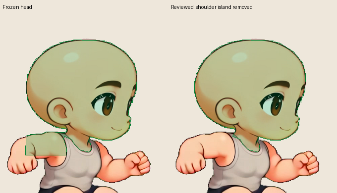

# Native male jump protection review

The separate registration candidate receives **44 reviewed head-protection
corrections across the 50 male jump frames**. Frozen registration and source
images are unchanged. These are metadata edits; they do not redraw a body,
change source alpha, normalize anatomy or create hidden hands.



The frozen head contour often follows connected shoulders and raised arms,
forming horizontal green bands across the upper body. The correction removes
those excursions while retaining the original upper cranium/face/ear contour.
Visible lower head and neck joins use explicit native-coordinate splices. Six
frames already had suitable head contours and remain unchanged: **57, 58, 60,
68, 69, 70**. Corrected frames are **59, 61–67 and 71–106**, all from
`male-2360`, source frames 202, 204–210 and 214–249.

The machine-readable
[corrections](../../../../artwork/kling-side-expansion/templates/source-review/male-jump-head-corrections.json)
contain frame/source IDs, source pack/registration/RGBA hashes, complete
replacement polygons, original-vertex splice ranges, explicit inserted native
vertices and reasons. `pointUpdates` is empty: this packet does not modify
wrist anchors or hand protection. A separate registration consumer must verify
the source hashes, apply each polygon to the matching `head` label, then issue
a new registration hash. It must not overwrite the frozen registration.

Review covered all 50 original native lower-head boundary crops, all 50
before/after overlay pairs, and full native difficult poses including
source204, 208, 218, 220–223, 240 and 242. The images below preserve source
pixels at native crop scale; green is only a review overlay. No image warping
or pose interpolation is used.

- [Frames57–66](male-jump-head-00.jpg)
- [Frames67–76](male-jump-head-10.jpg)
- [Frames77–86](male-jump-head-20.jpg)
- [Frames87–96](male-jump-head-30.jpg)
- [Frames97–106](male-jump-head-40.jpg)

The [audit](../../../../artwork/kling-side-expansion/templates/source-review/male-jump-head-audit.json)
records source identities, unchanged frames, source-visible protection additions
and removals, and exact unchanged upper rows. The reviewed replacement polygons
have no proper self-intersections (maximum 60 vertices). These geometric
checks do not establish anatomical ground truth; lower jaw/neck guards are
conservative visual estimates. Actual fists must remain covered by the
separate hand review. Near/far arm identity and hidden anatomy are not inferred
by this packet. Other male actions and female registration review belong to
the coordinated garment-template and QA packets.

Reproduce the JSON, audit and overlays from frozen inputs:

```sh
python artwork/kling-side-expansion/templates/source-review/reproduce-male-head-review.py
```

The helper verifies fixed input hashes and rechecks them after generation. It
writes only this source-review packet and temporary crops under `/tmp`.
