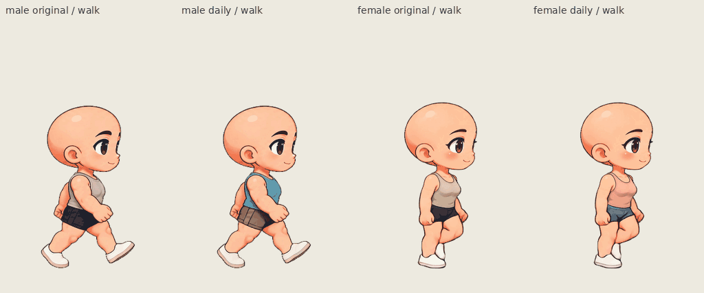

# Side-view movement and wardrobe candidate

Open the app, then **侧视动作与换装** on either character card. Direct routes:

- `/workbench.html?character=male&mode=side-view`
- `/workbench.html?character=female&mode=side-view`

This is a separate candidate built from the selected side-view video drawings.
The existing default characters, five-action source packs, wardrobe, themes and
optional skeleton tools remain available. This candidate does not introduce a
new skeleton or redraw the approved face/body.

## Try it

1. Choose the male or female character. **原片造型** preserves the source; **日常搭配**
   applies all three new pieces. Top, bottom and shoes can be mixed
   independently with their original counterparts.
2. Inspect idle, walk, run and the original **two consecutive jumps**, facing
   either way. Pause, step or drag the frame slider to review a precise pose.
3. Use A/D or the arrows to walk, Shift to run, Space to play the two-jump clip.
   Holding movement resumes locomotion after the complete clip; repeated Space
   cannot restart a jump midair. Button-triggered jump holds the final pose.
4. Compare **原地预览** with **横向移动**. Moving mode keeps the camera on the character
   while the ground ticks scroll. Reset displacement returns the travel counter
   to zero. Suggested speeds (530 walk / 700 run native px/s) are estimates from
   source foot travel, with adjustable sliders; this is not a physics controller.
5. Turn on original comparison and fitting guides. Save the editable project
   for later mixing, or export PNG, current-action GIF and CharacterPack. The
   independent `/player.html` loads the downloaded CharacterPack without this
   workspace. Guides and stage movement are not baked into exported artwork.

## Artwork and compatibility

The male **海盐日常** look uses a blue tank, sand shorts and cream shoes. The
female **杏桃日常** uses an apricot tank, mist-blue shorts and cream/pink shoes.
These are **same-cut material/color studies**, preserving the source clothing's
silhouette and folds. They are not newly painted shirts, sleeves or dresses.

All 107 male and 102 female frames retain their original 512×768 canvas, RGBA
source pixels, 24 fps timing and fixed (256,710) anchor before clothing is applied.
The new assets use existing CharacterPack V3 and wardrobe registration/garment
V1 formats; no parser migration or fallback action is needed. Their exact source
and registration hashes intentionally prevent old-view garments from silently
attaching to the new poses. Old packs/projects retain their old behavior.

Seventeen fitting anchors per frame guide future clothing. Visible joints are
estimates from inspected source poses; occluded joints are marked low-confidence.
They do not move the character. Native top/bottom/shoe ownership masks are
disjoint and preserve source alpha. The head, visible hands and independently
marked high-confidence skin pixels are protected. Reviewed source-specific cloth
polygons disambiguate warm fabric from skin-color seeds; their reasons and exact
source hashes are recorded in the registration audit. Ambiguous pale/blurred skin
is not claimed to be exhaustively detected.

For a genuinely new clothing cut, use these guides to paint and inspect native
pose-specific patches, including hidden coverage and front/back occlusion. A
single standing garment cannot automatically fit every moving source drawing.
The same source SHA, registration SHA, frame IDs, patch offsets and ownership
mask must accompany a reusable garment.

## Review evidence

The browser validation and export report is in [QA.md](QA.md). See also:

- [Current verification summary: 150 unit tests, build and four browser cases](verification-summary.json)
- [Visual inspection coverage, fixes and retained artifacts](visual-review.md)
- [Library entry screenshot](browser/round-4/library-side-links.png)
- [Source selection and motion behavior](motion-review.md)
- [Anchors, ownership and preparation details](../../artwork/kling-side-workspace/registration/README.md)
- [Actual browser run](browser/round-4/evidence-index.json)
- [Male / female movement and clothing comparison](review/pair-walk-run-two-jumps.gif)
- [Male native keyposes](review/male-keyposes-native.png) · [Female native keyposes](review/female-keyposes-native.png)
- [All review GIFs and input hashes](review/review-index.json)
- [Male standalone CharacterPack](browser/round-4/male-daily.character.zip) · [Female standalone CharacterPack](browser/round-4/female-daily.character.zip)
- [Male editable project](browser/round-4/male-daily.wardrobe.zip) · [Female editable project](browser/round-4/female-daily.wardrobe.zip)



| Same-pose original / daily comparison | Male                                                                    | Female                                                                      |
| ------------------------------------- | ----------------------------------------------------------------------- | --------------------------------------------------------------------------- |
| Idle                                  | [Right](review/male-idle-right.gif) · [Left](review/male-idle-left.gif) | [Right](review/female-idle-right.gif) · [Left](review/female-idle-left.gif) |
| Walk                                  | [Right](review/male-walk-right.gif) · [Left](review/male-walk-left.gif) | [Right](review/female-walk-right.gif) · [Left](review/female-walk-left.gif) |
| Run                                   | [Right](review/male-run-right.gif) · [Left](review/male-run-left.gif)   | [Right](review/female-run-right.gif) · [Left](review/female-run-left.gif)   |
| Two jumps, plays once                 | [Right](review/male-jump-right.gif) · [Left](review/male-jump-left.gif) | [Right](review/female-jump-right.gif) · [Left](review/female-jump-left.gif) |

Comparison layouts are made from actual browser-downloaded CharacterPacks.
Native PNGs and pack pages retain alpha; GIFs are half-size, palette-limited
previews on a beige background. The review sequence plays two walk cycles,
two run cycles and one complete two-jump clip, once. Browser recordings separately
show the interactive controller; the combined GIF is a review timeline.

## Remaining limits

- Walk is brisk; walk and run each have a 750 ms cycle. Different actions come
  from different source videos, so the head angle, shading and body pose can
  visibly change at a transition. Cycle-boundary switching avoids arbitrary
  mid-step cuts but cannot eliminate source identity drift.
- Jump contains two takeoffs and ends in a shallow landing crouch. It holds
  there unless another action is requested. A transition back to idle can pop;
  there is no invented neutral-recovery frame or crossfade.
- Source blur, some green spill and changing hand/foot contours remain. Uncertain
  clothing boundary pixels can retain small original-color strips/specks, including
  the male source242 outer shorts edge with a dark purple/ink fringe.
- Materials retain source lighting, so the male shorts are visibly darker in
  some walking poses. These first studies do not normalize shading across clips.
- Camera-follow speeds are estimates. No collision, gravity, foot-locking or
  new vertical trajectory is applied; vertical jump movement is already drawn.

## Reproduce

Run from the repository root with Python/Pillow/NumPy/SciPy/OpenCV and Node:

```sh
python scripts/prepare-kling-side-workspace.py
python scripts/prepare-kling-side-registration.py --repo-root . --output-root .
python scripts/prepare-kling-side-outfits.py
npm run build
```

The first script reads the already-normalized selected video frames; the second
uses the reviewed keypose inputs; the third prepares the six deterministic
garment banks. Browser checks then produce real downloads before review layouts:

```sh
EVIDENCE_DIR=/tmp/side-review-new CHROMIUM_PATH=/usr/bin/chromium node scripts/verify-kling-side-workspace.mjs
python scripts/review-kling-side-exports.py /tmp/side-review-new /tmp/side-review-layouts
```

Use a fresh evidence directory for each run; failed evidence is preserved.
