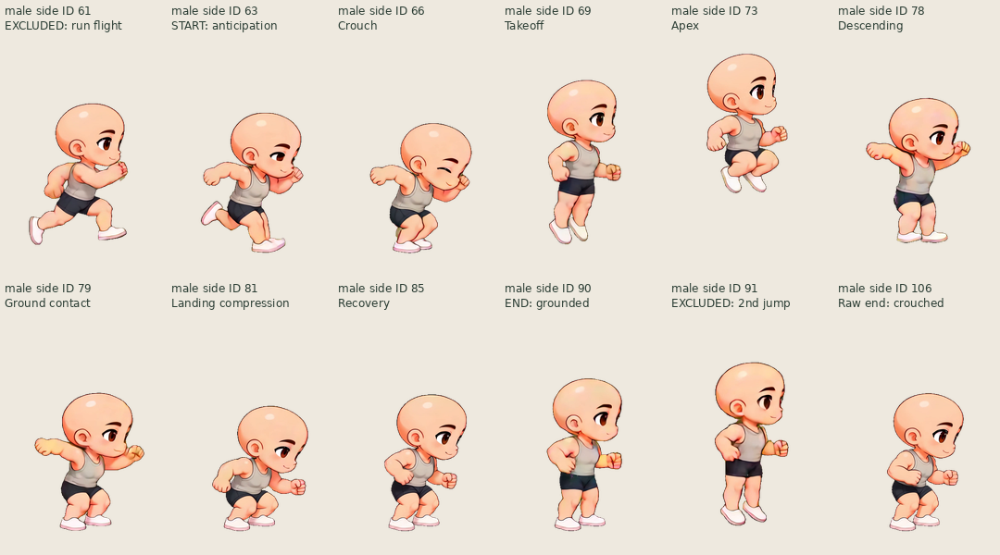
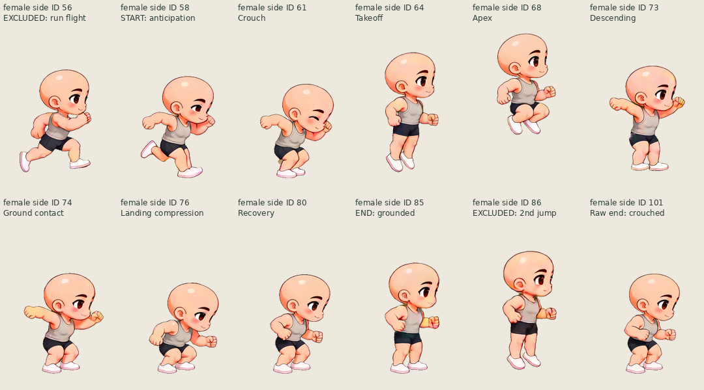
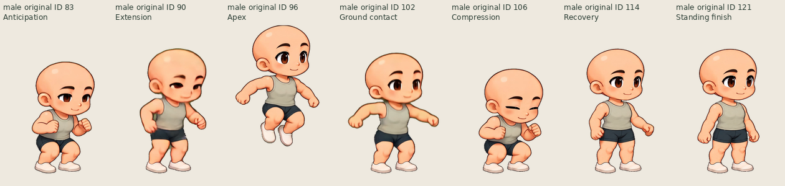
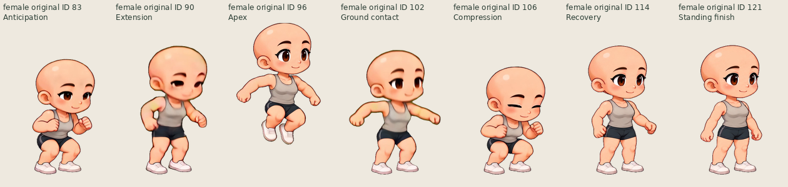

# One jump per trigger: source selection review

The original-view jump already contains one complete jump. The side-view source action contains a running approach, two jumps, and an incomplete second landing. Setting that old clip to `loop: false` cannot make its content a single jump.

This change selects existing atlas IDs. It does not redraw, deform, stabilize, blend, interpolate, recolor, repack, or replace any source drawing. The full source ZIPs and their original animation metadata remain available unchanged.

| View     | Character | Raw Jump IDs | Gameplay Jump IDs, inclusive | Timing                        |
| -------- | --------- | ------------ | ---------------------------- | ----------------------------- |
| Original | Male      | 83–121       | 83–121, unchanged            | 39 frames / 24 fps = 1.625 s  |
| Original | Female    | 83–121       | 83–121, unchanged            | 39 frames / 24 fps = 1.625 s  |
| Side     | Male      | 57–106       | **63–90**                    | 28 frames / 24 fps = 1.1667 s |
| Side     | Female    | 52–101       | **58–85**                    | 28 frames / 24 fps = 1.1667 s |

Side selection uses source video frames **206–233 inclusive** (interval [206/24, 234/24), approximately 8.5833–9.75 s) from `male-2360` and `female-2394`, respectively. The primary `source.sha256` of a side pack identifies another video; the jump video must be obtained from `sourceMetadata.selection.jump.source` and `sourceMetadata.sources`. Original-view selection uses the existing source frame interval 171–209 inclusive.

[selection.json](selection.json) records archive hashes, exact selected IDs, source-video hashes, source intervals, inclusive phase ranges, supporting alpha bounds, reviewed jump routes, and decoded RGBA hashes of the illustrated key poses. It is a review diagnostic, not an alternative runtime schema.

## Why this interval

| Phase                            | Male side ID | Female side ID |
| -------------------------------- | ------------ | -------------- |
| Planted-foot anticipation begins | 63           | 58             |
| Deep crouch                      | 65–66        | 60–61          |
| Extension, still grounded        | 67–68        | 62–63          |
| First flight arc                 | 69–78        | 64–73          |
| Apex                             | 73–74        | 68–69          |
| First ground contact             | 79           | 74             |
| Landing compression              | 80–82        | 75–77          |
| Grounded recovery                | 83–90        | 78–85          |
| Excluded second takeoff          | 91           | 86             |

The second jump is a poorer standalone candidate: it ends at male106 / female101 while still crouched, without a complete upright recovery. The chosen first jump reaches an upright grounded drawing before the next takeoff.

We also inspected starting two frames earlier, at male61 / female56, to soften the run-to-anticipation head dip. Those drawings contain a running flight pose, with the lowest visible pixel about 30 / 35 px above the idle ground line. The next drawing descends before the planted anticipation. Including them in the basic Jump action can make an idle-to-jump trigger appear to perform a small skip before the main jump, so they are deliberately excluded. A context-specific running approach is possible future work; it is not added here.

## Transition pose review

These route choices were checked against source contact sheets, front/rear arm orientation, knee bend, foot support, and body lean. Alpha bounds alone cannot identify an anatomically suitable transition. Existing registration points provide useful candidate ranking, but some near/far limb labels change across the native action sources; named-joint distance alone selected visibly worse arm phases.

`exit` is the source action boundary after that many playback ticks, and `entry` is the target zero-based playback index.

| Transition  | Male side                               | Female side                             |
| ----------- | --------------------------------------- | --------------------------------------- |
| Run → Jump  | After ID54: exit16 → entry0 / ID63      | After ID46: exit13 → entry0 / ID58      |
| Walk → Jump | After ID32: exit12 → entry0 / ID63      | After ID30: exit15 → entry0 / ID58      |
| Jump → Run  | After ID90: exit28 → entry11 / ID50     | After ID85: exit28 → entry8 / ID42      |
| Jump → Walk | After ID90: exit28 → entry7 / ID28      | After ID85: exit28 → entry11 / ID27     |
| Jump → Idle | After final jump drawing → entry0 / ID0 | After final jump drawing → entry0 / ID0 |

The run/walk entry choices approach a support pose with a rearward arm before anticipation. Run recovery starts in the matching arm half-cycle and a passing/forward stride, instead of always restarting the run at frame0. Run or walk requests received in flight must wait through landing and recovery; a new locomotion request must not cut directly out of the airborne arc. Other side locomotion-to-locomotion routes are cycle-boundary fallbacks unless separately reviewed; this document does not call them all artistically approved.

Original-view routes remain the existing source-bound `motionFlow` routes. Its one-shot jump already includes standing recovery and has no second takeoff to remove.

## Visual limits

This fixes the action content and scheduling, not every missing transition drawing. Side male90 / female85 is grounded and upright, but its arms remain bent and it was originally preparing a second takeoff. Returning to idle still drops the arms; entering anticipation still changes head pitch and arm position. Run, walk, idle, and jump came from different source videos, so the existing face/shading/viewpoint differences remain. Female walking also retains its previously documented light or briefly airborne foot poses. Source blur and colored edge spill remain visible in some jump drawings.

One-shot playback and intact source pixels can be verified technically. Seamless motion and final visual acceptance must still be judged on the actual composed/exported animation; this source review does not claim they are perfect.

## Native-source contact sheets

These previews share one fixed canvas per view and scale it uniformly for inspection. They are not replacement artwork.

