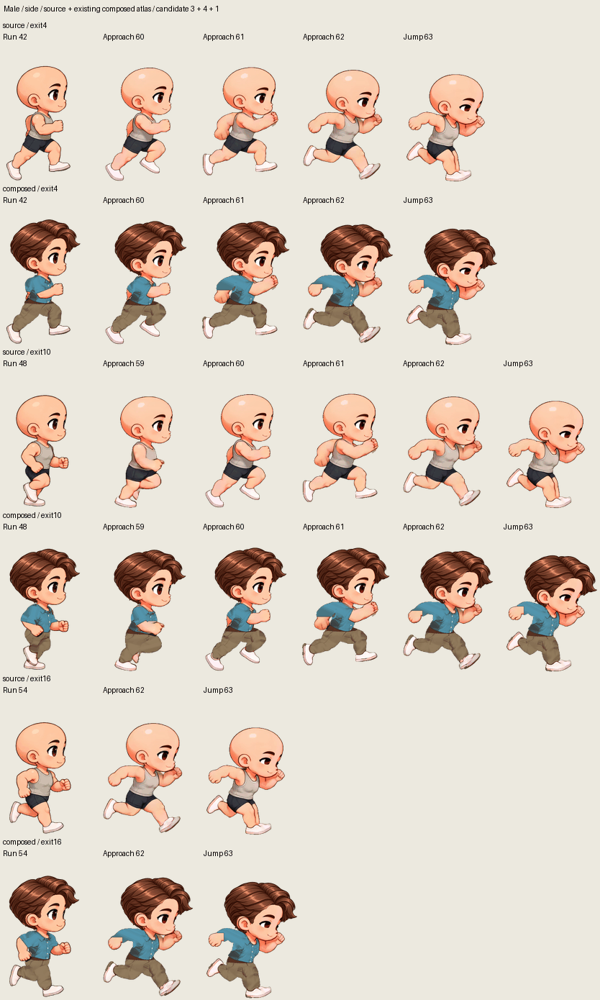
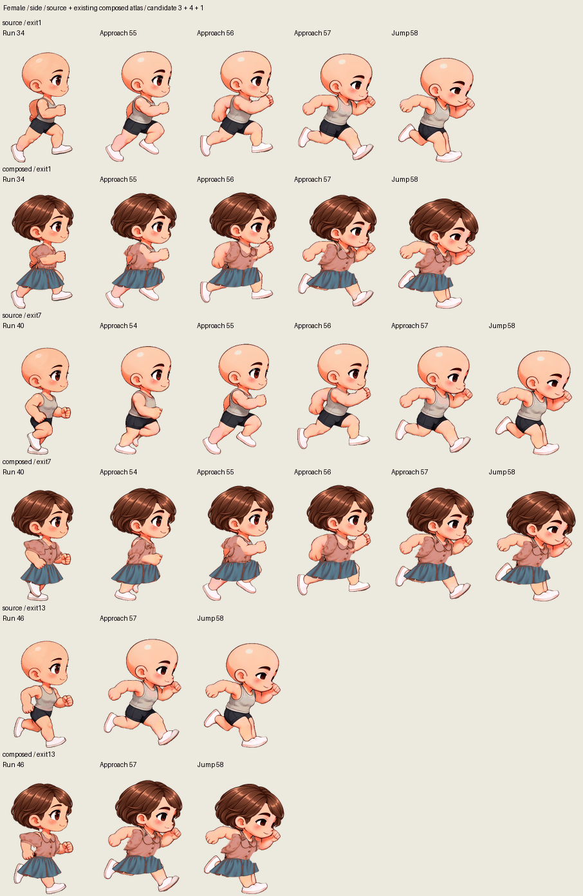

# 跑步起跳：按步态选择原生助跑帧

本轮使用侧视原视频中已经存在的助跑画面，连接循环跑步与单次 Jump 的落脚蓄力。画面取自原素材和既有应用导出的换装图集，没有补绘、插帧、变形、移动锚点或调整每帧时长。

以下是选帧证据，**不是新控制器或实际导出已经通过验收的证明**。最终效果还需检查应用生成的完整左右 GIF。原视角、基础 Jump、落地出口和完整蓄力阶段保持原样。

## 采用的三处入口

`exit` 是播放完多少个跑步 tick 后的边界；帧号是原生图集 ID。所有素材仍为 24 FPS。

| 人物 | exit | 跑步末帧 | 助跑帧         | 基础 Jump 起点 | 助跑时长 |
| ---- | ---: | -------: | -------------- | -------------: | -------: |
| 男   |    4 |       42 | 60、61、62     |             63 |    125ms |
| 男   |   10 |       48 | 59、60、61、62 |             63 | 166.67ms |
| 男   |   16 |       54 | 62             |             63 |  41.67ms |
| 女   |    1 |       34 | 55、56、57     |             58 |    125ms |
| 女   |    7 |       40 | 54、55、56、57 |             58 | 166.67ms |
| 女   |   13 |       46 | 57             |             58 |  41.67ms |

第一处入口对应向前摆臂、迈步中的姿势。第二处对应交叉腿与抬膝，接入较早的助跑画面；先前将这些姿势直接接到落脚蓄力会使腿突然放下。第三处已经接近落脚，只保留一个前倾助跑姿势，随后进入完整 Jump。

助跑帧只用于 **Run → Jump**。待机和走路触发 Jump 时，不加入这段跑步；单独导出的基础 Jump 也不加入它。部分助跑画面包含正常跑步的双脚离地阶段，不能将这一小段称为主跳跃已经起跳。

## 响应时间的具体含义

18 tick 的跑步周期现在有三个相隔 6 tick 的入口。控制器从请求到开始助跑的最长排队时间，从近 11 tick / 458.33ms 降为近 **6 tick / 250ms**。

助跑本身也需要时间。最长路径是等待 6 tick，再播放 4 tick 助跑，因此到基础 Jump 的落脚蓄力起点最多近 **10 tick / 416.67ms**。按此前的动作分段标签，再经过 6 tick 进入已标记的腾空段，最多近 **16 tick / 666.67ms**；这个检查点不是对足部最早离地瞬间的精确判定。这些上限不包含浏览器调度、合成和绘制延迟，不表示瞬间离地。

男版基础 Jump 仍为 63–90，女版仍为 58–85；此前选帧记录将 69、64 分别标为腾空段起点。改变的是按步态接入助跑的方式，而非加速 Jump 或删去蓄力。

## 未采用的候选

**男版 58 的发型跳动。** 较长方案原本从 58 开始。源人物的轮廓顶部在 47、58、59 为 y236、242、235，变化不大；相同帧的换装人物顶部却为 y158、200、154。该未使用帧的既有头发呈现明显下沉，加入播放会引入新的发型跳动。最终方案不使用 58，也不为这次衔接修正它的美术资产。

**最后入口加入两个助跑帧。** 男版 54 → 61 → 62 会让最低脚点从 y702 到 y682，再到 y698；女版 46 → 56 → 57 从 y709 到 y682，再到 y698。两种情况都在接近落脚时重新插入明显腾空姿势。最终只保留 62／57，减少多一次向上反弹的感觉。男版的头发顶部由原先直接 y156 → y192，分为 y156 → y164 → y192；这只是辅助测量，不能据此认定所有关节都已自然。

**把助跑加到基础 Jump 开头。** 这会让待机跳跃先做一个跑步小跨步，改变原地跳跃内容，因此未采用。

## 素材证据与视觉边界

每张图使用固定原生裁切范围、统一显示比例和共享 256 色检查调色板。源素材和换装图集的坐标、原生像素没有改变。换装帧来自 `e2d58db` 的实际应用导出；[selection.json](selection.json)记录源 ZIP、导出 ZIP、逐帧 RGBA、预览文件 SHA-256，以及透明度边界、锚点和入口时长。

原视频的头部俯仰、脸部阴影差异、部分衣料边缘和模糊仍存在。女版 57 → 58 的头发轮廓位置也仍有变化。本轮通过真实助跑帧分散姿态变化，不能宣称无任何形变或抖动；原图集证据与最终连续播放的视觉验收需分别报告。

