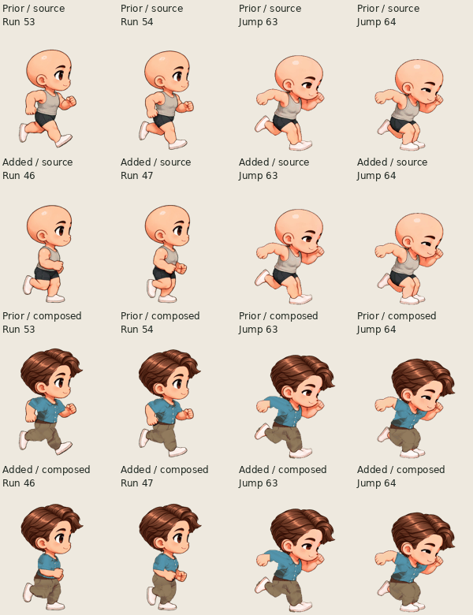
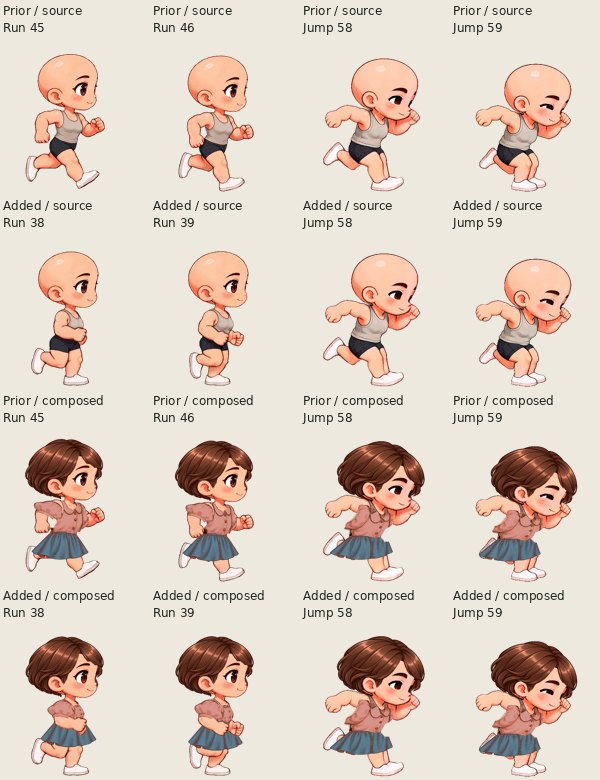

# Side-view takeoff: a second supported input window

The previous side-view controller accepted Run → Jump at only one boundary in an 18-tick run cycle. A request just after that boundary could wait almost 750ms. This review adds one more supported pose per character, retaining the original boundary and all jump preparation, flight, landing and return frames.

| Character     | Retained route         | Added route               | Jump entry       |
| ------------- | ---------------------- | ------------------------- | ---------------- |
| Male / side   | exit16, after native54 | **exit9, after native47** | entry0, native63 |
| Female / side | exit13, after native46 | **exit6, after native39** | entry0, native58 |

`exit` counts complete run playback ticks; it is not an atlas ID. The new exits are separated by 7 and 11 ticks. At the unchanged 24 FPS, the maximum wait falls from just under **18 ticks / 750ms** to just under **11 ticks / 458.33ms**. This is a response-window improvement, not instant input. Original-view exits5/13 remain unchanged, as do all Jump → Run landing routes.

## Pose choice

At male47 / female39 the hands have reached the waist, the trailing leg is folded backward, and the support foot is lower. The first jump drawing's backward arm swing and forward body lean can follow as anticipation. The source's head pitch and stance still change at the boundary; no new transition drawing is introduced.

Two alternatives were rejected:

- **Male45 / female37** would produce evenly spaced windows and a 375ms maximum wait. However, the near arm is still forward across the torso, whereas the first jump drawing extends it backward. That arm reversal was too abrupt to accept merely for shorter latency.
- **Male48 / female40** has a slightly closer arm position, but its front knee has started rising. Replacing that pose with the jump's plant is less coherent, and its maximum input wait would increase to 500ms. The preceding male47 / female39 is the better compromise.

The composed silhouette's top y-coordinate illustrates why this is **not** a head-dip repair:

| Character | Retained run → jump neighborhood  | Added run → jump neighborhood     |
| --------- | --------------------------------- | --------------------------------- |
| Male      | IDs53 → 54 → 63: y151 → 156 → 192 | IDs46 → 47 → 63: y159 → 158 → 192 |
| Female    | IDs45 → 46 → 58: y198 → 203 → 186 | IDs38 → 39 → 58: y202 → 202 → 186 |

These bounds are supporting measurements, not a substitute for inspecting the limbs and body. The extra window avoids a full front-to-back arm flip; it does not eliminate the separate source clips' pose differences.

## Source and composed evidence

Each sheet shows the retained boundary and the added boundary in both the native source and the existing composed CharacterPack. All cells use one fixed native crop and a uniform display scale. The 256-color sheet is an inspection presentation, not a replacement asset.

[selection.json](selection.json) records exact native IDs, archive hashes, per-frame RGBA hashes, bounds and route timing. The composed drawings come from actual application exports of `a7fbdce`; they are unchanged pose-selection references. New runtime behavior and exported GIFs require their own verification.

The side-view profile revision becomes `single-jump-v3`; original-view profiles remain V2. No source pixels, clothing, facial proportions, anchors, run cadence or jump content changes in this selection.
