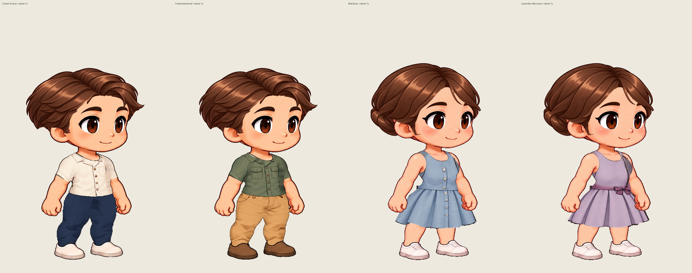

# Four new Kling outfits

This batch adds two painted shirts and two painted dresses to the existing two
Kling characters. It preserves the original source motion, face/body geometry,
all previously released clothing/appearance banks and the current default.

Open the running application:

- `/workbench.html?character=male&mode=wardrobe` → **Cream & navy** or **Forest weekend**.
- `/workbench.html?character=female&mode=wardrobe` → **Mist blue** or **Lavender afternoon**.

The choices appear in **Complete outfits**. The new shirts also appear under
**Top**, and the dresses under **Dress / one-piece**. Existing pants and shoes remain
available for mixing. Hair, face, direction and action controls still work.
Existing saved projects reopen with their embedded assets and saved selection.

| Outfit             | New item                                                   | Accompanying items                           |
| ------------------ | ---------------------------------------------------------- | -------------------------------------------- |
| Cream & navy       | Cream camp shirt                                           | Existing navy trousers; original white shoes |
| Forest weekend     | Forest work shirt, two chest pockets                       | Existing ochre chinos and brown shoes        |
| Mist blue          | Sleeveless button-front dress with painted waistband/folds | Original shoes                               |
| Lavender afternoon | Sleeveless pleated dress with plum waist bow               | Original shoes                               |

The generated design sheet is a cloth donor. The review below comes from actual
application PNG / CharacterPack downloads, not from that concept sheet.



- [Male run — right](review/male-two-outfits-run-right.gif) · [left](review/male-two-outfits-run-left.gif)
- [Female run — right](review/female-two-outfits-run-right.gif) · [left](review/female-two-outfits-run-left.gif)
- [Cream: five actions](review/cream-navy-five-actions-right.gif)
- [Forest: five actions](review/forest-weekend-five-actions-right.gif)
- [Blue: five actions](review/mist-blue-five-actions-right.gif)
- [Lavender: five actions](review/lavender-afternoon-five-actions-right.gif)
- [Native size lineup](review/four-outfits-1x.png); each outfit also has native
  keyframes and a 2× integer-scale collar/cuff/waist/hem crop in `review/`.

All GIFs are labeled 0.5× compact previews with a fixed frame origin. GIF
centisecond timings use cumulative rounding; repeated holds may be merged.
The five-action review sequence repeats, while the actual CharacterPack keeps
the original per-action loop flags (including one-shot jump).

Standalone packs, exported by the app:

- [Cream & navy](evidence/accepted-male/male-cream-navy.character.zip)
- [Forest weekend](evidence/accepted-male/male-forest-weekend.character.zip)
- [Mist blue](evidence/accepted-female/female-mist-blue.character.zip)
- [Lavender afternoon](evidence/accepted-female/female-lavender-afternoon.character.zip)

Authoring and checks:

- [Source, prompt and cloth-only tracing](../../../artwork/kling-wardrobe/source/casual-collection-v1/README.md).
- `scripts/prepare-kling-casual-collection.py` prepares registered pose patches.
  Existing male V2 sleeve ownership and female V4 skirt fitting are reused.
  New female bodices transfer generated buttons and folds, not just a recolor.
- The first actual male export exposed striped extrapolated cloth at the side
  of a crouching shirt. The accepted iteration smooths only that extrapolated
  texture field, preserving the generated inner collar/pocket/button pixels.
  The same correction removes angular padding wedges at the blue bodice neck.
  Actual before PNGs remain in `iteration1/`; final matching comparisons are in
  `review/`. The interrupted first capture is not counted as a passed workflow.
- A single faint source-shorts edge pixel in female pose 114 lay just outside
  the new lavender hem. Only that authored cloth fringe is covered with the
  immediately adjacent new cloth at the source alpha; no skin-color deletion.
- [Asset audit](asset-validation.json): every new atlas/mask/frame is decoded;
  protected head/hands and old asset hashes are checked. Full loaded inventories
  still fit the existing item-count and 128 MiB project limits.
- [Current technical checks](technical-checks.json) distinguish this batch from
  historical tests. [Actual-export checks](artifact-validation.json) cover native
  RGBA outside selected ownership, timing, mirrors, transparency and every GIF.
- `evidence/accepted-*/evidence-index.json` records real PNG/ZIP downloads,
  save/reopen pixel equality, mixing, existing outfit roundtrips and isolated
  player observations after all editor pages have closed. Saved wardrobe ZIPs
  are retained locally with hashes in the index; the independent character ZIPs
  and all needed source/garment/registration assets are committed.

The real-material run also exposed cache thrashing: Forest weekend with the new
hair and Gentle face needs about 196 MiB of decoded active pages; a female
dress / tucked-bun / Gentle / brown-shoes mix can need 222.3 MiB. The former
192 MiB cache repeatedly evicted pages needed by the same frame, timing out an
appearance preflight. `src/wardrobe/garment-pages.ts` now keeps a bounded
256 MiB / 8-page cache. `catalog-budget.test.ts` checks the shipped presets and
separates mixes against that working-set limit. PNG bytes, rendering rules,
archive/schema limits and original motion are unchanged. This is a targeted
fix for usable clothing/face switching, not a broader loading-speed rewrite.

## Visual limits

The [visual review](visual-review.md) records the inspected poses and findings
separately from functional and export checks.

The source tank opening and original arm contours still constrain collars and
short sleeves. Folds compress during deep crouches; skirt side waists can form
a hard concave turn under the source arm. The dresses are registered 2D cloth
drawings, without physical cloth simulation. Original video blur / matte fringe
and existing appearance-layer imperfections are unchanged. These are reviewable
new clothes, not a claim of finished animation art or user visual approval.

## Reproduce

```sh
python3 scripts/prepare-kling-casual-collection.py
python3 scripts/build-kling-wardrobe-catalog.py
python3 scripts/verify-kling-casual-collection.py
CASUAL_CHARACTER=male CASUAL_RUN=accepted-male node scripts/capture-kling-casual-collection.mjs
CASUAL_CHARACTER=female CASUAL_RUN=accepted-female node scripts/capture-kling-casual-collection.mjs
python3 scripts/render-kling-casual-collection.py --runs accepted-male accepted-female
```

Use fresh `CASUAL_RUN` names for reruns; the capture refuses to overwrite an
existing evidence index. Authoring requires Pillow, NumPy and SciPy; capturing
requires project Node dependencies and Chromium (default `/usr/bin/chromium`).
