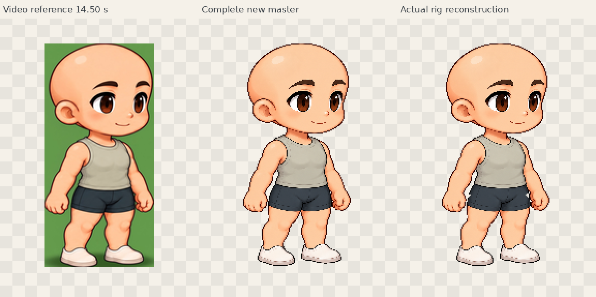
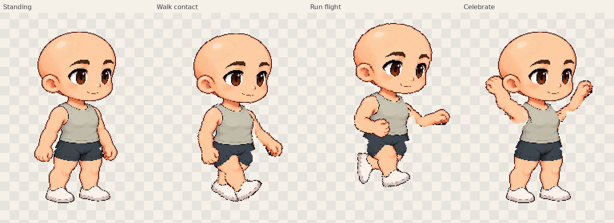

# Reference mother — review candidate

One fixed mother model, four static validation poses. Existing defaults remain
unchanged. [Implementation and limits](../REFERENCE_MOTHER_REVIEW.md).

## Review images

- [Native comparison](review/reference-master-rig-1x.png) · [2× comparison](review/reference-master-rig-2x.png)
- [HD master versus HD part reconstruction](review/master-reassembly-hd.png)
- [Four poses 1×](review/four-poses-1x.png) · [2×](review/four-poses-2x.png) · [Actual transparent left sheet](final/four-poses-left-1x.png)
- [Neck/shoulder](review/neck-shoulder-4x.png) · [Elbow/hip](review/elbow-hip-4x.png) · [Knee/ankle](review/knee-ankle-4x.png)
- [HD part inventory](review/parts-hd-inventory.png) · [Actual candidate page](final/candidate-viewer.png)
- [Celebration with bones](final/ui-celebrate-bones-right-2x.png) · [Closed-page independent-player proof](final/player-run-right-static-hold.png)

## Download and reuse

- [1024 × 1536 transparent master](../../artwork/reference-mother/prepared/master-hd.png)
- [15 HD parts + registration ZIP](../../artwork/reference-mother/prepared/parts-hd.zip)
- [Complete editable pose-study ZIP](final/reference-mother.pose-study.zip)
- [Project rig ZIP](../../artwork/reference-mother/prepared/project.rig.zip)
- [Actual joints and hierarchy](../../artwork/reference-mother/prepared/rig.json) · [Four poses](../../artwork/reference-mother/prepared/poses.json) · [HD registration / parents / draw order](../../artwork/reference-mother/prepared/layer-registration.json)
- [CharacterPack: three static holds](final/reference-mother-static-holds.character.zip)

The last ZIP contains **three stills**, not completed animation loops. The
existing idle/walk/run selectors display the standing/contact/flight pose;
celebration remains in the pose-study archive. Hands compile into forearms,
only neutral expression is authored, and large-bend cloth contours still need
refinement. [Source record](../../artwork/reference-mother/source/README.md) ·
[Browser evidence](final/evidence-index.json) · [Integrity checks](review/integrity.json).
